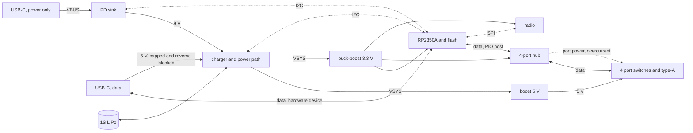

# crossfire hardware

The production board: an RP2350 hosting four USB instruments through a hub, powered from USB-C over
Power Delivery, with an optional radio and an optional battery.

**Status: prototype, nothing built.** Every number below is a budget or a datasheet figure, not a
measurement. A predecessor design exists elsewhere as a sketch of an earlier vision; it was never
manufactured or validated, so nothing here is inherited from it — individual parts are reused only
where they stand up on their own.

## What the board has to do

- Host four USB-MIDI instruments at once, on four type-A receptacles, each supplied with 5 V.
- Keep the firmware that already exists: the USB device role and its console, the signed
  A/B image pair with probation, and the radio update path.
- Present itself to a computer on the upstream connector *while* hosting the instruments, so the two
  roles live on separate interfaces.
- Take its power from an upstream USB-C connector, separate from the one a computer plugs into.
- Optionally carry a radio for over-the-air updates and for a client app to control it.
- Optionally run from a LiPo cell for at least an hour under load.

## Three decisions shape everything else

### 1. Two USB roles on two interfaces

The RP2350 has **one** USB controller, and the board needs two roles at once: host for the four
instruments, device for the computer on the upstream connector. The roles are kept apart on separate
interfaces — the hardware controller takes one, and a full-speed port built in PIO takes the other.
Nothing is multiplexed and nothing switches role, so a computer and the instruments are live at the
same time.

**The hardware controller faces outward as the device, and PIO hosts the hub.** The deciding
argument is recovery, and it beats the alternative on its own terms:

- **The boot ROM drives the hardware controller.** Putting that pair on the upstream connector means
  BOOTSEL and USB DFU work on the connector the product actually has. Recovery needs no debug probe,
  no case opened, nobody on the bench.
- **It makes the risky new thing the recoverable one.** The host side is what has to be rebuilt, and
  if that goes wrong the board can still be reflashed over its own port. The other way round, a rough
  device port takes the console and DFU with it and leaves only SWD.
- **Bring-up starts working rather than blocked.** The board is programmable and has a console over
  its own connector before any of the new firmware exists, so the host side can be brought up
  incrementally against a board that already talks.

What it costs, plainly: **the host role moves onto a new transport.** The existing host stack sits
behind a host-controller seam, so the stack, the hub handling and the MIDI layer above it are kept —
but the packet-level transport underneath becomes a full-speed USB host built in PIO, which does not
exist in this tree. That is the single largest piece of new firmware this board asks for, and it is
the harder of the two roles to build: it has to generate frames, schedule transactions across four
devices and a hub, and handle retries.

The device side, by contrast, is already proven on hardware — the console rides it today. The one
addition there is the computer-facing MIDI interface, which is a device class on a working stack.

**The upstream connector is unambiguous.** It sinks power and acts as a device, both, always — so
the CC lines mean one thing, there is no role to choose, and the charger-versus-computer guess that a
multiplexed design would have needed is gone. Electrically it is also the simpler end: the hardware
controller's pins carry their own impedance matching and pull-ups, so the pair needs only an ESD
array and the receptacle's two data pairs tied together, so a cable can go in either way up.

**The PIO port sets the system clock, and it sets it upward: 240 MHz.** Full-speed bit timing off PIO
wants a system clock that is an integer multiple of 12 MHz, so the state-machine divider is exact and
the bit period carries no fractional jitter. The stock 150 MHz is not such a multiple. Going *down* to
120 MHz would satisfy it at the cost of a fifth of the loop; going up to 240 MHz satisfies it and buys
the loop instead, and four things line up on that number:

- **12 MHz × 20.** Twenty system cycles per bit, and an exact divide by two if the state machine wants
  to run at 120 MHz. Either way the divider is an integer.
- **Twenty cycles a bit is a generous instruction budget** for the hardest software on the board. Ten
  would have been tight. The clock that makes the timing legal also makes the program easier to write.
- **It is already proven on this silicon.** A board in this codebase runs RP2350 at 240 MHz today,
  from the crystal through a 1440 MHz VCO and a divide by six, at stock core voltage.
- **The flash stays at its fastest legal clock.** A 133 MHz part divided by two off 240 MHz is
  120 MHz. Higher multiples are worse here, not better: 288 MHz would need a divide by three and drop
  the flash to 96 MHz.

So the constraint that looked like a tax is a 1.6× clock increase, and the forwarding loop gets
faster rather than slower. The device port is unaffected either way — its 48 MHz comes from the other
PLL.

**It is an overclock, though, and that is the part to weigh.** 240 MHz is above the datasheet's
150 MHz. It is proven on the boards in hand; it is not characterised across a production population
or a temperature range, and a product ships into both. What to establish before committing: whether
stock core voltage still holds at temperature, and what the fallback is if it does not — 192 MHz
(12 × 16) is the next multiple down that still beats stock, and 120 MHz is the floor that always
works.

The PIO port is the host end, so it carries 27 Ω series resistors on the pair and host-side
pull-downs; the 1.5 kΩ pull-up belongs to the hub, which asserts it on its own upstream port. It runs
entirely on the board, from GPIOs to the hub, and never reaches a connector or a cable — which is the
kindest possible first home for a software-timed USB port.

One consequence of hosting on-board: **no host supplies VBUS to the hub's upstream port**, so the hub
is self-powered, and its upstream-detect input is driven by the MCU. The datasheet is explicit about
this case: a *detachable* hub divides that pin down from the upstream VBUS, but a self-powered hub
with a permanently attached host takes it "from a dedicated host control output, or the 3.3 V domain
that powers the host" — so a GPIO, which costs one pin and hands the firmware the ability to hold
the hub down until it is ready and to force a re-enumeration by toggling it. Without that pin
asserted the hub never believes it is connected.

### 2. Two upstream connectors, one for power and one for data

Power and data arrive on **separate USB-C receptacles**. One connector would force a choice: a port
negotiating 9 V off a charger is not a port a computer is plugged into, so whichever you wanted, you
gave up the other. Two connectors means a 27 W brick and a computer at once, and neither constrains
the other.

| | receptacle | carries |
| --- | --- | --- |
| power | type-C, power only, 6-pin | CC to the PD sink, VBUS to the charger — the designed power input |
| data | type-C, USB 2.0, 16-pin | D+/D− to the hardware controller, Rd on both CC pins, ESD, VBUS sensed |

Splitting them also cleans up what each one means. The power port negotiates without caring what a
computer would think of the result. The data port is only ever a data link — BOOTSEL, DFU, the
console and the MIDI interface all live on a connector that does nothing else.

**The data port still contributes a little power**, and it has to. Without it, a board with no
battery and no charger cannot be reflashed from a laptop, which is exactly the situation a
manufacturing line and a returned unit are in. Its contribution is capped at the USB default: about
2.5 W, which runs the MCU, hub and radio and trickles the cell, and does not pretend to run the
ports. That is not a limitation worth fighting — a laptop was never going to supply the 10 W four
ports can ask for.

> **The reverse blocking has to be automatic, not timed by firmware.** The moment the power port
> negotiates 9 V, that voltage must not appear on a laptop's VBUS, and there is no software fast
> enough to be trusted with it. So the data port's contribution goes through a reverse-blocking
> element that the higher voltage shuts off by itself.

**Neither way of plugging it in wrongly does harm**, which matters because two identical receptacles
on one edge guarantee someone will. A charger in the data port presents as an ordinary 5 V source and
is used as one. A computer in the power port supplies 5 V and simply has no data pins to reach. Both
cases degrade; neither damages.

### 3. What "under load" means

Four ports at full USB 2.0 spec is 4 × 500 mA = 10 W, and an hour of that needs a cell around
4500 mAh. Class-compliant MIDI instruments draw 100–250 mA. Sizing the battery for a load no MIDI
instrument presents buys a much larger cell for nothing.

**Taken as:** the ports run to **full spec on external power**, and to a declared **250 mA each on
battery**. The power manager already exists and is portable, so the budget is policy rather than
silicon — the current limits in the port switches protect the hardware, and the policy decides what
is offered. This is the one assumption here that most wants confirming.

## Block structure



*Solid lines carry power or USB data; dashed lines are control.*

## Power

### Rails

| rail | source | sized for | why |
| --- | --- | --- | --- |
| VSYS | the charger's system node, 3.0–4.4 V | 4 A | the battery when unplugged, held up by the charger when not |
| 5 V (ports) | boost from VSYS | 2 A | **always the same converter**, so a port sees the same 5 V plugged in or not |
| 3.3 V | buck-boost from VSYS | 1 A | VSYS falls below 3.3 V on a flat cell, so a plain buck could not hold it |
| 1.1 V (core) | the MCU's own switching regulator | — | not a board converter, but it needs board parts: an inductor on `VREG_LX` and a feedback network, which is why it is a rail and not just decoupling |

The core rail catches people out, so it is worth stating: this MCU regulates its own core with a
*switching* regulator, not a linear one. It brings out `VREG_VIN`, `VREG_LX` and `VREG_FB`, so the
schematic carries an inductor and the rail it makes feeds the `DVDD` pins. The analogue supply for
the ADC wants its own filter off 3.3 V as well, which is worth keeping even with nothing presently
reading through it.

Port power comes from VSYS rather than straight off VBUS. It costs a conversion when plugged in
(about 90%), and it buys two things: a 5 V rail that does not change character when the cable is
pulled, and the freedom to negotiate 9 V upstream instead of being held to the 15 W that 5 V/3 A
allows. The cost-down that would have removed the boost — ports fed from VBUS, with the charger's
OTG output back-driving it on battery — died with the single upstream connector: VBUS is now a
power-only receptacle, and back-driving it powers nothing. The separate boost is settled.

### Budget

**3.3 V rail**

| | typical | peak |
| --- | --- | --- |
| RP2350A, both cores at 240 MHz, USB active | 110 mA | 150 mA |
| QSPI flash, executing in place | 15 mA | 25 mA |
| hub | 90 mA | 120 mA |
| radio, connected idle / transmitting | 60 mA | 350 mA |
| indicators, crystals, pull-ups | 25 mA | 40 mA |
| **total** | **300 mA** (0.99 W) | **685 mA** (2.3 W) |

**5 V rail**

| | current | power |
| --- | --- | --- |
| full USB 2.0 spec, 4 × 500 mA | 2.00 A | 10.0 W |
| declared battery budget, 4 × 250 mA | 1.00 A | 5.0 W |
| four typical MIDI instruments | 0.4–0.8 A | 2–4 W |

**Upstream**

Worst case on external power is 10.0 W of ports and 2.3 W of device, which is 13.6 W at VSYS after
conversion and about 14.8 W at the PD rail. Charging a 3000 mAh cell at 1.5 A adds 6 W.

> 5 V/3 A is 15 W and cannot do both. **Request 9 V at 3 A (27 W)**; accept 9 V/2 A with the charge
> current trimmed; fall back to 5 V/3 A with the ports held to the battery budget.

**Battery**

At the declared budget the board draws 6.7 W at VSYS. An hour of that is 6.7 Wh; a 1S cell at 3.7 V
nominal carries 1800 mAh of it, and roughly 90% is usable down to cutoff before any allowance for
age.

> **Specify a 3000 mAh 1S LiPo (11.1 Wh), rated 2 C continuous or better.** That is about 77 minutes
> at the declared budget and about 42 minutes with every port drawing its full 500 mA. Peak
> discharge at full spec is around 3.5 A, which is why the C rating is called out.

## Parts

Stock KiCad symbols exist for everything marked with one; the rest need drawing.

| block | part | symbol | why |
| --- | --- | --- | --- |
| MCU | RP2350A, QFN-60 | `MCU_RaspberryPi:RP2350A` | 30 GPIO is enough (see below); RP2350B if a display is added |
| flash | W25Q128JVS, 16 MB | `Memory_Flash:W25Q128JVS` | the A/B image pair plus the asset partition; 2 MB would not hold it, and its 133 MHz rating covers the 120 MHz the divider lands on |
| hub | USB2514B | `Interface_USB:USB2514B_Bi` | four downstream ports, per-port power and overcurrent pins, no external EEPROM needed |
| port switch ×4 | TPS2065C | `Power_Management:TPS2065CDBV` | 1 A threshold, **active-high enable, open-drain fault** — what the hub needs at both ends. It limits by going into constant current rather than latching off, and adds reverse blocking and output discharge, both of which a port wants. Its 0.5 A sibling is the same trap as before: that is the budget itself, with nothing for inrush |
| port data ESD ×4 | 2-channel array, low capacitance | — | needed because the switch above protects power only. The TPD3S0x4 would have covered both, but it has no fault output, so it cannot tell the hub anything |
| PD sink | HUSB238 | `Interface_USB:HUSB238_xxxDD` | already proven on hardware in this codebase, and it reports which profile was accepted |
| charger / PMIC | BQ25798 | `Battery_Management:BQ25798` | buck-boost, takes 9 V in directly, 1S charge, and an I²C ADC the power manager can read |
| 5 V boost | TPS61089 | `Regulator_Switching:TPS61089` | 5 A switch, comfortably 2 A out at 5 V from a 1S cell |
| 3.3 V | TPS63060 | `Regulator_Switching:TPS63060` | buck-boost, so 3.3 V survives a flat cell |
| ship switch | DMNH4015SSD | `Transistor_FET:Q_Dual_NMOS_S1G1S2G2D2D2D1D1` | the same package again, both halves in parallel: ~10 mΩ at the 4.5 V available, so 35 mV and 0.12 W at the 3.5 A peak, and 18 mV at the declared budget. 30 nC against a 100 nA charge pump at half duty is about 600 ms to close, which is nothing for a power-path switch |
| input switch ×2 | DMNH4015SSD | `Transistor_FET:Q_Dual_NMOS_S1G1S2G2D2D2D1D1` | one dual N-channel package per upstream port — the two sources tied together, the two gates tied to that port's driver. 40 V, 20 mΩ at the 4.5 V the charger's charge pump provides, 7.5 A, ±20 V gate, AEC-Q101. Pin 1 S1, 2 G1, 3 S2, 4 G2, 5–6 D2, 7–8 D1 |
| upstream data ESD | 2-channel array, low capacitance | — | the downstream pairs get theirs from the port switch; the upstream pair has no such part in front of it |
| power connector | USB-C, power only, 6-pin | `Connector:USB_C_Receptacle_PowerOnly_6P` | no data pins to mis-wire, and nothing on it a computer would want |
| data connector | USB-C 2.0, 16-pin | `Connector:USB_C_Receptacle_USB2.0_16P` | |
| port connectors ×4 | type-A | `Connector:USB_A` | |
| radio | Radio Module 2 (RMC20452T) | `crossfire:RM2`, drawn here | the same CYW43439 the firmware is already proven against, as a module rather than a bare chip so the radio arrives certified. Chosen over the other module of the same silicon because this one presents the **serial** host interface the proven driver speaks; the alternative offers only the wider bus. 21 castellated pads, −30 °C to +70 °C |
| radio bus resistors | 470 Ω, 10 kΩ | `Device:R_Small` | not optional: one host pin serves three module pads, and these are what let it |

Two notes on the hub. Its upstream link runs at full speed, because the RP2350's controller is
full-speed only — so the whole tree is full speed and instruments that could do high speed fall
back, which costs nothing, as USB-MIDI 1.0 is a full-speed class. And the hub drives the port
switches itself: `PRTPWR[1:4]` to each switch's enable, each switch's fault back to `OCS_N[1:4]`. Port
power then goes on and off through ordinary hub requests that any host stack already makes,
overcurrent arrives as a standard port status change, and eight GPIOs stay free.

### Passives

A value on its own is not a specification, so every capacitor now carries a **voltage rating and a
dielectric**, chosen from the net it sits on rather than from a house default. The rule is at least
twice the working voltage, rounded to a standard rating, and never below what a socket the user can
reach is able to present.

| what it decouples | rating | dielectric |
| --- | --- | --- |
| the core rail, 3.3 V, the system rail, the cell, the bootstraps and the internal filter nodes | 16 V | X7R |
| the 5 V rail, each port's own output, the charger's input and the node beside it | 25 V | X7R |
| the connector side — the sink's own supply, and the data port's | **50 V** | X7R |
| crystal loads, the feedback tap and the compensation network | 50 V / 16 V | **C0G** |

Two of those rows are decisions rather than arithmetic.

**The connector-side parts are rated for abuse, because nothing on the board protects them.** Both
input switches sit *downstream* of them, so the sink's own supply decoupling and the data port's
are exposed to whatever a hostile charger produces, with no switch between. They are rated for a
fault rather than for the 9 V and 5 V they are supposed to see.

**The charger's own input bank is rated 25 V on a condition, and the condition is firmware.** The
input over-voltage trip defaults to **26 V**, which is above a 25 V part — so rating the bank for
the working voltage is only safe if that trip is moved down. The part offers 7 V, 12 V, 22 V and
26 V, and **12 V is the right one for this board**: the sink never asks for more than 9 V, so 12 V
clears the profile with room and bounds what the bank can ever see. This is a board decision that
creates a firmware requirement, which is exactly the sort that gets lost, so it is written here as
well as in the firmware's own notes.

**Resistors carry a tolerance, and it is 1% only where the value is read.** Nineteen of the
thirty-eight are: a reference a part trims itself against, a divider ratio, a termination that
states what this end of a cable is, a value that programs a threshold at power-on. The other
nineteen are pull-ups, pull-downs, straps and series parts, where 5% is honest and 1% is a cost
with nothing on the other side of it. Power is not a field: the largest dissipation anywhere on
the board is a few milliwatts in an indicator's series resistor, so the smallest standard part
covers every one of them.

**Three values were arithmetic that had never been rounded to a part you can buy.** Two are the
charger vendor's own figures for the temperature network -- 5.24 k and 30.31 k, neither of which
exists -- and one was ours for the boost's current limit. They become 5.23 k, 30.1 k and 174 k,
and the cost of each is stated rather than waved at: 0.2% and 0.7% on the temperature thresholds,
which is a fraction of a degree, and about 2% on the current limit.

That last one is worth stating properly, because the shorthand for it invites a misreading. The
limit is **not** set *at* the worst-case peak. The boost's switch has to pass about 4.25 A at the
bottom of the cell with every port drawing its full share, so a limit there would trip in normal
service; it is set at about **5.9 A**, which clears that peak by nearly 40% and still leaves the
converter protecting itself. The two resistance figures the vendor publishes against measured
limits are what fix the relationship, and they also fix its direction: more resistance, less
current.

**The four inductors are specified by what they have to carry, not by their value alone**, and two
of the four had their value fixed for them by a decision already taken.

| | value | has to stay unsaturated to | why that number |
| --- | --- | --- | --- |
| core regulator | 3.3 uH +/-20% | **1.5 A** | the processor's own datasheet says so, along with a 250 mohm ceiling on resistance |
| charger | 1.0 uH | **7 A** | the input can deliver 27 W and the system sits near 4 V, so the output side carries about 6.3 A, plus half the ripple |
| 3.3 V buck-boost | 1.0 uH | **3 A** | above the converter's own 2.0-2.5 A limit, so the part protects itself before the core does |
| 5 V boost | 2.2 uH | **7 A** | above the 5.9 A the current-limit resistor sets, for the same reason |

**The charger's inductor value is not a choice.** Its datasheet is explicit that 1.5 MHz works only
with 1 uH and 750 kHz only with 2.2 uH -- and the frequency was already fixed, at power-on, by the
resistor that also sets the cell count. One resistor therefore picks the inductor, and the two have
to be changed together or not at all.

**The core regulator's inductor has a requirement that is easy to lose**: it must be fully shielded
and **marked for polarity**, and oriented the way the vendor's layout shows. Their own note is that
stray field from the inductor couples into the regulator's control loop and moves the output even
with nominally shielded parts. That is a placement constraint arriving from a component datasheet,
so it is recorded here where layout will look for it.

**The crystals are specified by load, not just frequency**, because the load is what decides
whether they oscillate on frequency at all. Both work out at **10 pF**, and both vendors name the
arithmetic rather than leaving it to be guessed.

The processor's is simply stated: its vendor recommends a specific part and publishes its
parameters, 10 pF load and +/-30 ppm either side. The hub's has to be derived, and the derivation
is the part worth writing down, because the obvious way to do it is wrong. Stray capacitance sits
in parallel with **each** loading capacitor, not with the two of them in series -- so the load is
not half the pair plus the stray, it is half of *(the pair plus the stray)*. With the 18 pF the
hub's own documents call typical and a few picofarads of board stray, that is about **10.5 pF**,
and the nearest standard part is 10 pF. The naive arithmetic gives 12 pF, which is a different
part. Both of the vendor's two formulations -- the older datasheet's and the newer checklist's --
agree on this once they are read carefully.

Its frequency allowance is **+/-350 ppm**, and that number is a trap in the other direction: it is
the *total* the hub can tolerate, so a part sold as +/-350 ppm would spend the entire budget before
temperature and ageing are counted. A commodity +/-50 ppm part meets it several times over.

**There is no feedback resistor across either crystal, and none is wanted.** The hub's datasheet
figure draws a 1 Mohm across the pins without saying which side of the package it is on; its
design checklist, which exists to list what the board has to provide, asks only for the two
loading capacitors. The same checklist confirms two things already drawn: the 12.0 kohm 1%
reference to ground, and that the reset line may be held by the processor rather than pulled up,
which is what the pull-down and the GPIO on it amount to.

### Mechanical, and the connectors

**The enclosure is drawn around the board, not the board around an enclosure**, and the first one
runs bare on a bench. That ordering decides more than it sounds like: the board may take whatever
outline suits it, but it has to be usable with nothing around it, so parts that are pressed or
looked at face upwards rather than sideways, and anything that takes a plug's insertion force goes
through the board rather than resting on pads.

**One constraint fixes the board's width, and it is the port pitch.** Four type-A receptacles at
**25.4 mm between centres** span 76.2 mm centre to centre. The widest stock footprint for a
full-size horizontal receptacle occupies 22.8 mm and the narrowest 15.4 mm, so every one of them
fits the pitch -- the narrow end leaving about 10 mm of clear board between neighbours, which is
where each port's switch, its protection array and its bulk capacitor have to live. Taking the
narrow one, the four ports occupy 91.6 mm of courtyard, and with a few millimetres of edge each
side **the port edge cannot be shorter than about 100 mm**. That is now a fixed dimension of the
product, not an outcome of layout.

It is worth recording *why* 25.4 mm rather than something tighter, because it looks generous
against a 13 mm receptacle and invites being trimmed later. The number is not about the
receptacle, it is about the **plug**: a moulded type-A plug is commonly 16 to 20 mm across, so a
narrower pitch yields a hub whose four ports cannot all be used at once. That is the failure this
product exists to avoid.

| | part | why |
| --- | --- | --- |
| downstream ports x4 | full-size type-A, horizontal, **through-hole** | the plug's force goes into the board. Every stock option is through-hole, which settles it |
| upstream data | 16-pin type-C, surface pads with **through-hole shell tabs** | the signal pads are fine surface mount; the shell takes the strain through the board |
| upstream power | **6-pin** type-C, same mounting | see below |
| indicators | 0603, **red and green** | the 1 kohm series resistor rules out the high-voltage colours |
| buttons x3 | 6 mm surface-mount tactile, top-actuated | one part for all three, pressable on a bare board |
| debug | 5-pin header on 2.54 mm | bench-first means a header that any probe's flying leads reach |
| cell | two-way, 2.0 mm pitch | a two-wire pack, which is what is actually sold; the sensor it does not carry is on the board |

**The power port is physically a different connector from the data port, and that is worth having.**
A 6-pin power-only receptacle is a stocked part with a stock footprint, so taking it costs nothing
over using a 16-pin part with its data pins unconnected -- and it means the power port **cannot**
carry data, in copper rather than by labelling. The two receptacles were always going to be told
apart by what is printed beside them; this makes the printing a convenience rather than the only
thing standing between a user and a surprise.

**The cell is a two-wire pack on a 2.0 mm connector, so the thermistor moves onto the board.** The
charger's temperature network is unchanged -- the same two resistors, computed by its vendor for a
10 kohm sensor -- and the thermistor now sits across the lower leg exactly where the pack's one
would have connected. It must be a **10 kohm B3435** part, because that is the sensor those two
resistors were calculated against; a different beta moves both ends of the window.

**What this protects against changes, and the change is worth being honest about.** A thermistor
inside the pack watches the cell. One on the board watches the board. It can no longer catch a cell
heating up on its own -- the failure people picture when they think of battery thermal protection --
and what it does instead is refuse to charge when the surroundings are too cold or too hot for
charging to be safe. That is not nothing: charging a lithium cell below freezing plates lithium and
damages it permanently, and ambient is a fair proxy for a resting cell's temperature. But it is a
different guarantee, and the specification should say which one the product makes.

**It also turns a component into a placement requirement.** The sensor has to sit against the cell
and away from everything that gets warm -- the charger, the two converters and their inductors. Put
it near a heat source and it reads high and refuses to charge a perfectly good cell; put it out in
open board and it reads ambient and reports nothing about the battery at all. Of the two mistakes
the first is the one that will be blamed on firmware.

**The indicators' series resistor has already chosen their colour, which is worth noticing before
someone fits a blue one.** They run from a 3.3 V pin through 1 kohm, so the current depends entirely
on the forward voltage: about **1.3 mA** for red, amber or ordinary green, and about **0.3 mA** for
true green, blue or white, which is not enough to rely on seeing. The low-voltage colours are
therefore not a preference here, they are a requirement of the resistor already drawn. Taken as
**red and green**; swapping to blue or white means changing the resistor too, and at that supply
there is very little headroom left to do it with.

1.3 mA is deliberately modest rather than accidental -- a modern part is clearly visible at it
indoors, and two indicators left on cost the cell about a fiftieth of its capacity a day.

**The three buttons are one part, surface mount, top-actuated, at the edge.** One line item covers
all three, a 6 mm actuator is comfortable to press on a bare board, and an enclosure then wants a
hole rather than a plunger. Two notes for whoever draws that enclosure: the user button is the only
one an owner should be able to reach, since the other two put the board into its bootloader and
reset it, so recessing them is reasonable even though all three sit on the same edge. And the user
button has **no pull-up on the board** -- it relies on the processor's internal one being enabled,
which is ordinary, but it means the pin reads as floating until firmware has configured it.

**Four M3 mounting holes, plated and bonded to ground.** Bonded rather than bare because the
asymmetry favours it: five connector shells on this board are already at ground, so if the enclosure
is metal a screw into a metal standoff should join that system deliberately rather than through
whatever it happens to touch, and if the enclosure is plastic the bond does nothing and costs
nothing. The decision that cannot be undone without a new board is the one to leave the pads off.

**Where they go was not a choice.** Three of the four corners are inside a part -- the bottom edge is
four sockets on a fixed pitch spanning nearly the full width, and the top right is the radio's
clearance, which a screw and its standoff have to respect as much as copper does. The usable
positions are the point furthest from the middle of the board in each quarter where a fastener
actually fits, taking 8 mm of clear diameter as the figure, because an M3 head is 5.5 mm and a washer
7 mm and a hole only the drill clears is one that cannot be done up:

| | position | |
| --- | --- | --- |
| H1 | 4.0, 6.5 | the one true corner |
| H2 | 95.5, 14.5 | pushed down the right edge, clear of the antenna |
| H3 | 36.5, 59.5 | as low and as far left as anything fits |
| H4 | 81.5, 59.5 | |

**Two consequences belong to the enclosure, not the board.** There is no hole position anywhere in
the lower left, because the power section fills it. And nothing comes within 16 mm of the row of
sockets, which is exactly where a plug is pushed in -- so the enclosure has to carry that row on a
ledge rather than rely on these four screws to take the force. Both follow from the port pitch and
the antenna, and neither can be fixed by moving a hole.

**Each capacitor's package is chosen from how much of it has to survive its own bias**, which is
the last thing a value and a rating leave undecided. The question is not how much capacitance is
printed on the part, it is how much is there once the voltage is across it, and the answer differs
by package for the same value and rating.

The requirement is derived rather than assumed, bank by bank:

| bank | what it has to do | effective value needed | fitted | so it must keep |
| --- | --- | --- | --- | --- |
| charger input, 9 V | hold input ripple to 100 mV at 5.4 A through the inductor | **8.6 uF** | 20 uF | **43%** |
| 5 V rail | hold output ripple to 50 mV at 2 A | 24 uF | 66 uF | 36% |
| system rail | answer a load step, not ripple -- ripple alone wants 2.5 uF | 25 uF | 92 uF | 27% |

**The charger's input is the binding case at 43%, and it is the reason the package matters.** That
much is comfortable in 1206 and marginal in 0603 for a 10 uF part at 9 V, so the five capacitors on
the 9 V nodes take 1206 and everything at 4.5 V or under, which is a long way up its own curve,
takes 0805. Decoupling goes to 0402, where being close to the pin matters more than the package,
and the small frequency- and loop-setting parts to 0603, where there is nothing to derate.

**The answer to the question this opened is that the counts do not change.** Every bank is adequate
as drawn, provided each part keeps roughly half of itself, and that is what the package choice
delivers. What remains is a purchasing check rather than a design one: the chosen part number's own
bias curve has to show it clearing the figure in the table above.

Two notes on where the vendors differ. The 3.3 V converter's datasheet says outright that its
recommended values **anticipate** tolerance and bias derating, and quotes 20% and 50% -- so its
table is nominal and the margin is already in it. The charger's and the boost's say nothing of the
kind, so for those the derating is ours to carry, which is what the table above does. And the
processor is the one part that specifies an **effective** tolerance: its core regulator's output
capacitor must be 4.7 uF +/-20% *in circuit*, not nominally, which is a tighter thing to satisfy
than it looks.

### Footprints

**132 of the 135 parts carry a footprint.** Most are decided the moment the part is -- a SOT-23-5
is a SOT-23-5 -- and the capacitors' came out of the bias calculation above. The resistors are all
0603 rather than 0402: the board has room, the first one runs bare on a bench, and a part you can
get a probe or an iron onto is worth more there than the millimetre it saves.

**The radio module's footprint is the vendor's own, and taking it corrected a near-miss.** The
module has no footprint in any stock library, so the obvious move was to draw one from the
dimension drawing in its datasheet. The pitch, the pad size and the pad length read off that
drawing cleanly -- but where each pad sits along its edge did not, and what I had was inference
from where things appeared in a rendered figure rather than a stated number. Raspberry Pi publish a
KiCad symbol and footprint for it; that is the one fitted. The drawn figure turned out to agree on
everything it stated plainly, which is some comfort, and says nothing about the parts it did not.

Taking the official symbol also **checked the pinout drawn here against theirs**, and all 21 pins
agree. Four carry different names -- their `DI` and `DO` for this document's data in and out, their
`nIRQ` and `WL_ON` for its interrupt and enable -- and nothing else differs. The pin numbering
derived from the module's own table is therefore confirmed against its author rather than merely
self-consistent.

**That footprint did arrive with one defect, which the silkscreen check found.** Its reference field
is hidden, and a plain text reading `REF**` is left visible in its place -- so the module would have
been printed with the placeholder and never with its designator, on every board built from it. The
placeholder text is removed and the field itself prints, which is what every other part on this board
does -- pointing the spare text at the reference was the quicker fix and left the module printing its
designator twice, once where the pass chose and once under its own body where nothing can be read.
Worth noting as a class of error: an imported footprint can be correct in every dimension that
matters electrically and still be wrong in what it prints, and only one of those two is checked by
comparing it against a drawing.

**Every part has a footprint, and the provisional ones were checked against their own vendors'
data rather than left to a body-size match. Two of the three were wrong.**

The 3.3 V converter's was wrong in kind rather than by a margin. Its maker's land pattern puts a
*shaped* thermal pad under the part -- a centre rectangle with fingers and tabs, thirteen pieces in
all -- and gives the signal pads extended toes beyond the body. The generic entry has a plain
rectangle and no toes. That shape is the thing in the drawing that looked like a drafting flourish
and is not: it is the pattern. The library carries the real one under the vendor's own package
code, which is what is fitted.

The hub's was wrong by 0.2 mm in each direction. Its datasheet tabulates a **recommended** land
pattern, not merely a package outline, and names a 3.70 mm pad where the provisional entry had
3.90. Too large is the direction that floats a part off its pins on reflow.

The power sink's was right, and worth confirming rather than assuming: its vendor's exposed pad is
1.70 x 2.40 nominal against the 1.65 x 2.38 fitted -- a few hundredths under, which is the safe
side to be on.

The two remaining inductors took a footprint the library keeps under a family name, and its 4 mm
entries at both heights carry **identical pads** -- which independently confirms the shared land
pattern that made the taller, higher-current part a free swap when it was chosen.

**The hit rate is the lesson.** Choosing a footprint by matching body size and pin count got two of
three wrong, and neither error would have shown in the schematic, the connection list or any rules
check -- only on a board that did not assemble properly. The drawings that settle it are pure
graphics with no text to extract, so they have to be rendered and read rather than searched, the
same way the module's pin-1 marker and the transistor's pin numbering were settled.

**The inductors are chosen, and two of them are the same part.**

| | part | why |
| --- | --- | --- |
| core regulator | Abracon AOTA-B201610S3R3-101-T | the processor's vendor names it, and publishes a layout built around it |
| charger | Coilcraft XGL4030-102MEC | 7.6 A before its inductance is down a fifth, against a 7 A worst case |
| 3.3 V buck-boost | Coilcraft XGL4030-102MEC | the same part again: one line item, one land pattern |
| 5 V boost | Wurth 744311220 | on the converter vendor's own recommended list |

**Saturation is quoted against an inductance droop, not as a single number**, which is what makes
these comparable. The charger's needs about 7 A at its worst, and the chosen part is still holding
80% of its inductance there; the first part considered reached that figure only at a 30% droop,
which would have fed back into more ripple and a higher peak still. The taller part in the same
4 mm footprint fixes that for a millimetre of height, and has lower resistance into the bargain.

The 3.3 V converter needs only 3 A, so using the charger's part there is generous. It is worth it:
one part number, one land pattern, one thing to stock, and lower resistance than the part its own
vendor suggests. That vendor's recommendation -- a 4 mm part 1 mm shorter -- is the alternative if
height ever matters more than the shared line item.

**Two footprints come from the processor vendor's own reference design**, which is published under
a permissive licence and carried into this project's footprint library with the notice that licence
asks for. One is the core inductor's. The other is the **processor's own land pattern**, which
settles one of the four packages that were fitted provisionally: the pad under that part is no
longer a guess at the nearest library variant but the pattern its maker lays out. Three provisional
packages remain.

What is left on the two Coilcraft parts is their land pattern, which is one drawing covering both
since the 4 mm family shares it.

### GPIO budget

Seventeen of the thirty, and the assignment is not arbitrary — the PIO pair is forced adjacent and the
rest fall out of keeping peripherals on their default pins.

| GPIO | net | why there |
| --- | --- | --- |
| 0, 1 | `CONSOLE_TX`, `CONSOLE_RX` | UART0's default pair |
| 2, 3 | — | spare |
| 4, 5 | `SDA`, `SCL` | I²C0's default pair; reaches the PD sink and the charger |
| 6 | `CHG_INT` | |
| 7 | `HUB_RESET` | |
| 8, 9 | `PIO_DP`, `PIO_DM` | **forced adjacent**, low pin first — the PIO program addresses the pair as a base and an offset |
| 10 | `RF_PWR` | |
| 11 | `RF_CS` | |
| 12, 13 | `RF_CLK`, `RF_DIO` | kept adjacent so the radio's PIO program can side-set the clock beside its data pin |
| 14, 15 | `LED_1`, `LED_2` | |
| 16 | `BUTTON` | |
| 17 | `VBUS_DET` | data-port VBUS present, so a self-powered device only attaches when a host is there |
| 18 | `HUB_VBUS_DET` | tells the hub its upstream is live; also the way to force a re-enumeration |
| 19–25 | — | spare, and still contiguous: seven in a row is a display bus |
| 26–29 | — | spare, and the only four that reach the ADC on this package |

Dedicated pins take the rest: QSPI to the flash, the hardware USB pair to the data receptacle, SWD to
the debug header, XIN/XOUT to the 12 MHz crystal, RUN to reset.

The boot button is not a GPIO. It pulls the flash's chip select low, the way the reference design
does, so it costs nothing from the budget above — and the button on GPIO 16 is a separate, ordinary
one.

## The board

**Four layers**, with the two inner ones named for what they are: a ground plane and a power
plane. Two would have been possible -- the processor's own vendor escapes this exact package on
two -- but their reference board has no hub, no switching charger and no radio. This one has three
switching converters wanting a solid return for their hot loops, a radio whose datasheet asks in so
many words for a good ground plane, six signal pairs wanting a continuous reference, and a 0.4 mm
pitch sixty-pin package sitting next to a thirty-six-pin one. Any one of those is survivable on two
layers; all four together are not.

**No controlled impedance, and that is a decision rather than an omission.** Every port on this
board runs at full speed, because the processor's own controller is full-speed only and the hub
therefore presents a full-speed tree. At twelve megabits a hundred millimetres of track is
electrically short, and the 90 ohm figure the USB specification quotes is a property of the cable,
not of the board. The pairs still get a class of their own -- routed together, over unbroken
ground, lengths loosely matched -- but the fab needs no impedance option, which is a real saving on
a four-layer board.

**The rules come from a board that is known to work with this processor.** Its vendor's reference
design uses 0.15 mm minimum track, 0.15 mm clearance and a 0.5 mm via on a 0.25 mm drill -- and
escapes the sixty-pin package with them on *two* layers. Taking the same numbers on four leaves
margin rather than demanding a finer process, and they are ordinary enough that no fabricator
charges extra for them. Two of the figures were set higher than that at first, and the parts
rejected both:

* **Clearance is 0.15 mm, uniformly, including on the power classes.** The processor's pads are on
  0.4 mm pitch and 0.23 mm across, so the gap between one pad and the next is 0.17 mm. That is a
  property of the package, and no rule above it can be satisfied by *any* board carrying the part.
  A class clearance is a routing figure -- how much air to leave between tracks -- and a pad field
  cannot honour one. Nothing is given away by lowering it: IPC-2221 asks 0.1 mm between uncoated
  external conductors below 30 V, and the highest potential anywhere on this board is a 20 V supply
  contract. The heavy rails still get more room than the floor wherever the layout allows; what
  changed is that this is a layout practice rather than a rule the parts break.
* **The smallest hole is 0.2 mm**, not 0.25. The boost converter's thermal pad carries vias of that
  size, deliberately small so solder does not wick down them and starve the joint. Through 1.6 mm
  of board that is an 8:1 aspect ratio, which is ordinary capability rather than a special request.

**The net classes are sized from the current each rail carries**, not left at a default. External
copper at one ounce and a ten degree rise carries roughly an amp in 0.3 mm, two in 0.8 mm, three in
1.4 mm and five in 2.8 mm, which gives:

| class | width | what it carries |
| --- | --- | --- |
| Default | 0.20 mm | everything carrying information rather than current |
| USB | 0.25 mm | the six pairs, as pairs |
| Power | 0.50 mm | up to an amp: the logic rails, one port's output |
| Power+ | 1.00 mm | two to three amps: the 5 V rail and the upstream feeds |
| Battery | 2.00 mm | up to six amps between cell, charger and system |

The heavy rails are expected to end up as poured copper rather than track, so those last two widths
are the floor for any stub that *is* tracked, not a plan for how the current gets there. There is no
separate signal class: the default *is* the signal class, which is one fewer thing to keep in step.

**The outline is 100 x 80 mm** with 1.5 mm corners. The 100 is not a choice -- it is what four
receptacles at 25.4 mm centres plus edge margin come to. The 80 is an estimate from what has to fit
behind them, and is expected to tighten once placement is real rather than guessed. The corners were
3 mm until the outer two receptacles were placed: a 3 mm radius cuts across the corner far enough to
reach their shield pads, so the radius is set by the parts nearest the corners rather than by taste.

**The board is designed at the origin and placed on the sheet last**, and those are deliberately two
different things. Designing at the origin is what makes every position here readable -- a part at
(17, 50) is seventeen millimetres from the left edge of the *board*, which is a fact about the
product. The sheet is not: its frame is inset ten millimetres from the paper and its title block
takes the bottom right of that, so a board left at the paper origin sits across the frame line in the
corner with the border running through it.

The last pass moves the whole design -- every footprint, track, via, pour, graphic and the outline --
as one rigid piece onto the sheet, centred across the page and clear of the title block. Nothing
moves relative to anything else, so no placement and no clearance can change. The offset is measured
from where the outline actually is rather than stored, so the pass can be run again without walking
the board off the page.

One real change came out of it. Refilling the pours at a new position left a few slivers of copper
with no connection to their own net, which the check reported as isolated copper. The pours now have
island removal turned on, which they should have had: floating metal is worse than no metal. It costs
3.2% of the 3.3 V plane and nothing measurable on the others, and what it removes is copper that was
carrying nothing.

### Placement

**All four sockets were placed facing the wrong way, and it took a person to see it.** Every
numeric check passed: the pitch was exact, the courtyards cleared, the rules check was silent, and
the thing was unusable -- mouths pointing into the middle of the board and their closed backs
presented to the edge. A board check tests whether parts collide, never whether a connector opens
where a plug can reach it.

The footprint settles the question and there was no need to guess. Its origin is at the pins and its
body runs from 2.77 mm behind them to **13.49 mm in front**: that 13.49 mm is the shell, and its far
end is the mouth. The mouth therefore faces the edge when the part is *not* turned, and the pins sit
13.49 mm inboard of it, which is where a right-angle socket's pins belong -- inside the board rather
than crushed against its edge. The two upstream connectors were already right and say so in their
own drawing, which carries a line marked **"PCB Edge"**; lining that line up with the outline is the
whole placement, and the front flange then overhangs by half a millimetre as it is meant to.

Two things follow. The mouths are flush with the outline and the port centres are exactly on 25.4 mm
pitch, which is the one fixed dimension of the product. And the port pins moved 12.6 mm inboard,
which shortens every data route and improves the clamp positions described below.

**The parts that cannot move were placed first and everything else fitted around them**, which is
recorded above. The remaining 113 are passives, and a passive's position is not a free choice: a
decoupling capacitor belongs at the pin it decouples, a divider at the pin it feeds, a load capacitor
at the crystal. Nearly all of that is already stated in the connection list, so it was read from
there rather than decided -- for each part, a pad of an already-placed part sharing one of its nets
is its anchor, and the part sits as near that anchor as there is room for. Ground is excluded from
anchoring: every one of these parts touches it and nothing is learned from that.

Two things the connection list does not say, both found by getting them wrong:

* **Which chip a rail capacitor belongs to.** On the net list every 3.3 V bypass is the same two
  nets, so the first attempt sent the radio's three and the converter's output bulk to the hub,
  which happened to own the nearest pad on the rail. The drawing does say, because a part is on the
  sheet of the block it serves. The sheet now comes first in choosing an anchor, and all 113 parts
  ended up beside something on their own sheet.
* **That a pin can only have one part beside it.** Six capacitors anchored to the same pad of the hub
  and fanned outward from it. A pad is claimed once used, so a chip with six supply pins gets its six
  bypasses spread one to a pin, which is what they are for.

**The four port clamps are on the back of the board**, and this is the one placement decision that
costs something. A clamp works by being nearer to the pin than anything it protects, because what it
has to beat is the inductance of the track in front of it. On the front it cannot get near: a
right-angle receptacle's shell covers the board for 13.5 mm, its pins sit inside that, and the best
free position outside it is **5.2 to 10.5 mm** from the pins depending on the port. Behind the shell
the same area is free, and the pins are through-hole so their pads reach it, so each clamp sits
**3.2 mm** from what it protects -- through the thickness of the board instead of around the
connector, and the same on all four ports rather than varying by a factor of two.

What this costs is that the board is no longer assembled on one side only: four parts of one type in
four similar positions, which is the cheapest form of that cost. The bulk capacitors stay on the
front, because eight millimetres to a 22 uF reservoir is nothing -- it holds a rail up over
microseconds, and the inductance that matters to a clamp does not matter to it.

**The designators were placed by the same method**, after the check found 108 of them printed on
exposed copper and 57 overlapping each other -- ink on a pad keeps solder off the joint, so this is
not cosmetic. Each one is placed outward from the centre of the part it names, clear of every pad on
its own face, every body outline, and every designator already placed, and they stay horizontal
whatever the part does, because a board is read in one orientation. All 144 are at 0.8 mm, which is
the board's own floor for printed text; the first attempt put the small parts at 0.7 and that is
simply below what the process is asked to resolve.

**The fast nodes are placed by measurement, not by the general rule**, and that correction was worth
more than any amount of careful routing afterwards. Three kinds of node on this board are not a
matter of taste: a converter's **switch node**, which swings the full input voltage in nanoseconds
and whose loop with the inductor and the input capacitor is the one that radiates; a **crystal's two
pins**, the most sensitive input a processor has, where added length collects noise and added
capacitance pulls the frequency; and a **bootstrap capacitor**, which has to hold a gate up for a
whole switching cycle. The area of those loops is set by where the parts are, not by how the copper
between them is drawn.

The first floorplan put the four power inductors and both crystals at positions chosen by eye, and
the result was a charger switch node 15.5 mm long, a core regulator's 10.7 mm, and both crystals
about 10 mm from the pins they serve. The general placement rule did not fix it, because it places a
part's *centre* near an anchor *pad* and has no opinion about which of the part's own pads ends up
facing it -- on a 7.3 mm inductor those are different questions, and the boost's sat with its switch
pad 13 mm from the switch pin and its output pad pointing at the converter.

So these parts are now asked the question directly: every pad that shares a net with a device pin is
given that pin as a target, and the part is searched over all four orientations and every position on
a fine grid for the one that minimises the total distance to its own targets without touching
anything. They are also placed **first**, before the bypasses, because a pad is claimed once and
whatever is placed first takes the position. Across the ten nodes that span **107.7 mm in total
originally and 46.6 mm now**; pin to inductor is 0.9 to 6.8 mm, and most are three to four.

**Sixty of the 112 two-terminal parts were facing the wrong way**, which the placement pass had no
opinion about: it turned each one so its length lay along the line to the pin it serves, but not
which *end* pointed that way. A decoupling capacitor with its ground pad towards the supply pin it
decouples is in the right place and the wrong way round -- the current has to run past the whole part
to reach the end it needs, and the loop is bigger by the length of the capacitor at both ends. It is
not only a matter of degree: it showed up as a hard failure, with a supply pin on the processor
unable to reach its own capacitor at all, because the straight line between them crossed that
capacitor's ground pad and the neighbouring pin. Each one is now turned so the pad carrying the net
they share is the near one. Nothing moved; only the orientation changed.

### Planes

**The first inner layer is solid ground and is never divided.** It is the reference the signal pairs
are routed over, and a return current follows its own signal rather than the shortest path, so a slot
cut across it would push that return the long way round and turn a tidy pair into a loop. Nothing is
worth cutting it for.

**The second inner layer carries the rails, and the split follows the current rather than the pin
count:**

| | shape | why |
| --- | --- | --- |
| system rail | the left block, 2–34 x 20–62 | everything it touches -- the charger that makes it, the two converters that draw on it, the cell and the ship switch -- is one block. It carries the most current on the board, over twenty millimetres |
| 5 V | the bottom band, stepping up beyond x 78 | made at the boost on the left, used at four port switches spread along the bottom edge seventy millimetres away. The step is for the fourth port's switch, which sits higher than the other three |
| 3.3 V | the rest of the layer | fifty pads from the processor in the middle to the radio in the corner: a rail that goes everywhere and carries about an amp |

The shapes are drawn to the pads, not guessed. A first attempt took the 5 V band up to y 52 across
the whole width, which put it directly under the hub and left that part's six supply pins with no
3.3 V plane beneath them at all.

**Fourteen pads deliberately sit over a neighbouring rail's plane**, and that is the right answer
rather than a defect. They are the two converters' own output clusters -- the boost's and the 3.3 V
converter's -- which stand inside the block that feeds them. One inner layer cannot give both the
input and the output of a converter their own copper in the same square millimetre, so those nodes
are local: they join up on the surface and drop to their rail where the plane begins. Every system
rail pad is over its own plane, and **no pad anywhere is over nothing**.

### What the vendor's own layout says, and what it corrected

The copper around the charger was drawn as a hull over every pad of each net, which produced blobs
sixteen to thirty-five millimetres across that then fought each other for the same ground. That is
not what a converter's layout looks like, and the vendor publishes the answer: the charger's
datasheet carries a **numbered layout priority list** and a **reference layout figure**, and the
other two converters' datasheets say the same thing in prose.

**The priority list is the finding, and this board had it inverted.** In order: the 0.1 uF
capacitors at the power pins come *first*, placed on the same layer as and on top of the IC; the
inductor comes *second*, and -- this is the part worth quoting -- the inductor is reached by "multiple
vias under the IC to internal or bottom layer traces", precisely **because** holding the capacitors
against the package leaves it nowhere nearer to go.

The reason is in the vendor's current-path figure rather than in intuition. The loops carrying
nanosecond edges are capacitor-to-switches-and-back: the input reservoir through one switch pair, the
output reservoir through the other. **The inductor is in neither of them.** Its current is
continuous, so moving it further out costs a longer conductor carrying a smooth current, which is far
cheaper than opening either switching loop. The boost's datasheet makes the same point in its own
words -- its output capacitor loop is "the most critical current path" -- and the buck-boost names
input capacitor, output capacitor, then inductor, in that order.

This board's placement rule ranked inductors above capacitors, on the reasoning that an inductor
carries the current. What carries the *edges* is the capacitor. So the charger's inductor held the
ground beside the package at 5.5 mm while the capacitors that close those loops sat at 8.9 mm on the
input reservoir and 16.0 mm on the system rail. Corrected:

| | the vendor's order | before | now |
| --- | --- | --- | --- |
| 1 | 0.1 uF at the charger's PMID pin | 8.9 mm | **1.6 mm** |
| 1 | 0.1 uF at the charger's VBUS pin | 15.5 mm | **1.4 mm** |
| 1 | 0.1 uF at the buck-boost's input | — | **1.2 mm** |
| 1 | 0.1 uF at the boost's bootstrap | — | **1.8 mm** |
| 2 | the charger's inductor, *pushed out* | 5.5 mm | 4.1 mm |
| 3 | the REGN decoupling capacitor | 8.7 mm | 5.5 mm |
| 5 | the battery reservoir | 14.0 mm | 13.2 mm |

**And the pours are local now, which is the same instruction read twice.** The list says the nearest
capacitors go on top of the IC and "the remaining bulk capacitors must connect with low impedance --
same layer with wide traces and/or through multiple vias -- back to PMID, SYS and GND". A reservoir
eight or twenty-eight millimetres away therefore belongs to the *plane*, not to the local pour.
Limiting each pour to the pads within 7 mm of the converter it serves took them from 16–35 mm blobs
to regions of 2–8 mm holding 3 to 19 mm2, which is the shape the reference figure shows: one compact
region per net, radiating from the package in the direction its own pins face.

**The drawing was one capacitor short, and the reference layout is what showed it.** Item one asks
for a 0.1 uF at the charger's SYS pin, on top of the IC. This board had one 0.1 uF on the system rail
and two parts entitled to it -- the charger's SYS pin and the 3.3 V converter's input, different pins
on different packages. One capacitor cannot sit on top of both, so **C97** was added to the drawing
beside the rail's other decoupling. Each pin now has its own at 1.6 mm and 1.5 mm.

**The switch nodes now leave through vias where the package allows it.** Item two, and it follows
from item one: with the capacitors held against the package the inductor has nowhere near to go, so
the switch pins take a column of vias to the back and the copper to the inductor runs there. It is
on the back rather than an inner layer deliberately -- the inner layers here are a solid ground plane
and the rails, and a switch node run between them would be a capacitor to both along its length,
which is the opposite of "minimize parasitic capacitance from this area to any other trace or plane".
On the back it faces ground on one side only.

Three vias at the pin and two at the coil, per item six, which asks for via quantity sufficient for
the current. **All five switch nodes are now off the top layer**, and every via is 0.6 mm -- the full
size, not a reduced one.

That is worth recording because the first attempts failed on three of the five and the apparent
answer was a smaller via. It was not. The vias were never too big; two things of mine were wrong, and
both reported themselves as "no room":

* **The wrong clearance.** This pass used 0.2 mm where the board's rule is 0.15. At 0.4 mm pitch that
  difference puts the edge of a neighbouring pin's envelope exactly on the centreline of the escape,
  so every position beside the pin was rejected and no via size made any difference.
* **The wrong direction out.** The escape was taken along the line from the middle of the package
  rather than along the pad's own long axis. The charger's switch pad is 0.20 by 1.00 mm on the top
  edge of its package, and the line from the centre leaves it at fifteen degrees to that edge, which
  walks the via into the ground pin 0.45 mm away.

A third was a real conflict rather than a bug, and the vendor's figure resolves it by geometry. A
bypass capacitor held hard against the pin *beside* a switch pin blocks the corridor that switch node
needs, which is exactly what happened on the charger -- the input reservoir sat 1.6 mm off its own pin
and directly across its neighbour's way out. In the reference figure the inductor is above the package
with the switch vias between them and the reservoirs are to the **sides**. So the corridor outward
from each switch pin is now reserved before any capacitor is placed, and the capacitors go around it.

**The boost needed nothing at all**: its land pattern already carries a through-hole pad inside the
switch pad -- the vendor's own via in pad, reaching both faces -- so that node was already off the top
layer. Adding vias beside a pin ringed by its own thermal pad was both impossible and unnecessary,
and the pass now recognises a footprint that has already done the job.

The board's minimum via was briefly lowered to 0.45 mm to allow smaller ones and has been **put back
to 0.5 mm**, because nothing on the board turned out to need less, and a rule looser than the design
is a violation waiting to pass unnoticed.

| | the vendor's order | before | now |
| --- | --- | --- | --- |
| 1 | 0.1 uF at the charger's PMID pin | 8.9 mm | **1.6 mm** |
| 1 | 0.1 uF at the charger's SYS pin | 15.0 mm | **1.6 mm** |
| 1 | 0.1 uF at the 3.3 V converter's input | absent | **1.5 mm** |
| 1 | 0.1 uF at the boost's bootstrap | — | **1.8 mm** |
| 2 | the charger's inductor, *pushed out* | 5.5 mm | 5.8 mm |
| 3 | the REGN decoupling capacitor | 8.7 mm | **2.2 mm** |
| 4 | 0.1 uF at the charger's VBUS pin | 15.5 mm | **2.0 mm** |
| 5 | the battery reservoir | 14.0 mm | **3.2 mm** |

### The charger's power pins cannot be reached by track

The charger is a 4 mm package on 0.4 mm pitch, and **every power connection it has arrives on a pad
0.20 mm wide**: two for the battery node, two for the input, one each for the system rail and the
input reservoir. Those nets are in classes sized at one to two millimetres because that is what the
current needs -- up to six amps between the cell, the charger and the system. A two-millimetre track
cannot enter a 0.20 mm pad, and necking it down to fit is not a fix: it makes the width a fiction
honoured everywhere except the one place the current is densest.

It is worse than a width problem. Those pins are **mid-edge, flanked by signal pins**, so copper
cannot pass either side of them: the gap between pads is 0.2 mm and two clearances do not fit in it.
A pin can only be left straight out from the package edge, and then the copper has to get *around*
the pin ring to reach the rest of its net. There is no path across the top layer at any width down to
the minimum, which was tested rather than assumed.

**So these are poured, not routed.** A pour is the right shape for a short, local, many-to-many
connection -- a pin to the two capacitors beside it and the switch beyond them -- and it is safe in a
way a track is not: a track drawn across a neighbouring pin shorts it, while a pour cannot, because
the filler keeps every other net's clearance as it fills. That is what makes it possible to do the
whole block at once without placing a segment by hand. The outlines are computed from where the pads
actually are, so they do not care where the board sits on the sheet.

**Eleven nets were classed wider than the pad they start from, and that is why nothing here could be
routed.** A class width states what a net carries across the board. It cannot state what a 0.20 mm
pad on a 0.4 mm-pitch package is able to emit, and this board was asking the charger'"'"'s input
reservoir for a 1.00 mm track and its battery node for 2.00 mm, each leaving a pad 0.20 mm wide. Not
a conservative setting but a dead one: every "can this be routed" question was really asking whether
a two-millimetre track fits through a fifth of a millimetre, and the answer was always no, so
everything became a pour.

Two changes, and between them most of the pouring disappeared:

* **A "Converter" class at 0.20 mm** for the nineteen nets that live inside a converter block -- the
  input reservoir, REGN, the battery node, the bootstraps, the switch nodes, and the local nets of
  the other two converters. Their current is bounded by the pads they start from whatever the copper
  beyond does, so 0.20 mm is the honest figure and not a compromise.
* **The escape is necked to the pad.** The rails that cross the board keep their wide classes --
  the system rail, 5 V, 3.3 V, the input feeds -- because out there width is about current. But the
  first half-millimetre out of a pin is not, so the escape is the narrower of the class and the pad,
  and widens afterwards. That is what a person does by hand and it is what the class could never say.

With both, the system rail, the 5 V and 3.3 V rails and the charger input all route by ordinary track
where before every one of them was poured. **Five pieces of poured copper remain, 12.3 mm2 in total**,
against better than a hundred in the first version of this.

**What this draws is a connection, not a region.** The case for pouring here is narrow and it is the
only case: a pin on a 4 mm package at 0.4 mm pitch cannot be reached by track, because its neighbours
seal both sides. Everything beyond that was mine rather than the circuit'"'"'s, and it took being told
three times to strip it back to what the argument actually supports:

* **The copper does not reach under the package.** The pad sits at the edge of the IC, so growing a
  box around it put copper a millimetre inside the outline, under the part, where it does nothing at
  all. The pad is grown OUTWARD only.
* **It does not gather up the rest of the net.** The other capacitors on a rail already have their
  own vias and traces; pouring out to them is a second path for parts that have one, and makes a
  small connection look like a plane. The system rail reached three parts and needed to reach one.
* **It does not pour where a track would do.** This is the rule the whole thing rests on and it was
  written down and not applied -- the first attempt poured for every pin of all three converters,
  feedback and enable and compensation included, none of which needs anything but a track. The
  question is now asked for every pin, and where a track fits, a track is drawn.

**Two connections wanting the same board is a conflict, not a priority question.** Pouring both and
letting the filler arbitrate carves each one in half, so instead of one working connection and one
left to think about, there are two broken ones -- and both pass the rules check, because split copper
with correct clearance breaks no rule. Three of nine were in that state and none of the numbers being
collected would have said so.

Each piece now claims its corridor, is cut against what is already claimed, and then has to **prove
it still joins its pin to its target in one piece of copper** or it is taken off. That test is the
only one that matters here and it is not "is there copper" -- a region that fills in two parts has
been carved around something and connects nothing while looking in every report like one that works.

So each piece is a chip pad, a neck, and the one thing that pad has to reach -- the via down to its
plane where the rail has one, the bypass capacitor where it does not -- and then it stops. Nine
pieces, **22.8 mm2 of local copper in total**, where the first version of this had better than a
hundred. Eleven further pins turned out to take an ordinary track and have one, which is eleven
connections that exist now and did not before.

### Stitching

A pour on its own connects nothing it cannot touch. Ground is the easy case, because the outer layers
are poured with it too, so every surface ground pad is already joined to the copper beside it and
what is missing is the link down: 94 stitching vias on an 8 mm grid tie the two outer pours and the
inner plane into one piece of metal, which is what keeps a return continuous when it has to change
layer along with its signal.

The rails each get a via at the pad, with a short stub to join them, because a surface pad has no
other way to reach the second inner layer. **The direction of that stub is the whole problem.** A
first attempt put the via at the nearest free position in any direction, which on a package with pads
0.4 mm apart means leaving a pad sideways, straight across its two neighbours: one net shorted to
another, two bridged under the mask and eight more too close to call. A pad escapes **outward along
its own long axis**, which is the direction its neighbours are not in. Taking the line from the
middle of the part instead is close but not the same, and the difference matters -- on a sixty-pin
package a pin a third of the way along an edge points out at twenty degrees to that edge, which is
enough to walk the via into the pad next door, and on a package with a pad under the middle of it
that line points at that pad rather than away from anything.

Three further things each had to be checked separately, because none implies the others: copper of a
different net has to clear the stub **as a segment** rather than as its two endpoints; a hole has to
clear every other **hole** whatever net it belongs to, since a drill knows nothing about nets; and a
stitching via has to land on copper that is actually there, or it is not a connection but a hole.

One more number was wrong and worth naming: the first pass used 0.25 mm clearance when the board's
own rule is 0.15 mm. At 0.4 mm pitch that difference is the entire gap -- it is the reason 25 supply
pins appeared impossible to connect when only two were.

The board check is clear: **0 violations and 0 footprint errors**, with 204 unconnected pads left,
down from 409. What remains is the signal routing.

### Routing, and what a written router was and was not good for

The plan was to route by script the nets where a rule exists and can be checked -- the twelve data
pairs as pairs, both crystals, the converters' switch nodes -- and route the rest by hand. That was
the right division and the wrong expectation of the tool. **The scripted router is not kept, and
three short routes are all that survives it.** It is worth saying why, because the attempt was not
wasted: it is what found the placement problem that mattered far more.

A maze search over the two outer layers was written, with a pair searched as one object -- the state
being the CENTRELINE between the two tracks, each offset half the pair pitch to its own side, so the
two come out parallel by construction. It routed. What it did not do was agree with the rules check.
Each disagreement, found and fixed, revealed another:

* **A pad's own cells were blocked**, because the centre of a pin on a 0.4 mm package is within
  clearance of the pins either side. True, and irrelevant: that copper is already there, and a track
  inside its own pad adds no clearance problem the pad does not already have. Until this was fixed
  the router could not start a route, and reported that it could not cross one millimetre.
* **A clearance halo was painted as a grown bounding box**, which blocks a rectangle's diagonals by
  the clearance in each axis at once -- a factor of root two too far at the corners. That is the
  difference between an escape corridor and a sealed one on fine pitch.
* **A pair cannot leave fine pitch as a pair.** It needs about a millimetre of clear width; between
  0.4 mm pins there is none and there should not be. A pair fans out as two separate tracks and comes
  together outside the part.
* **The fan-out itself was drawn without checking anything**, which produced thirty-nine shorts in
  one run -- a pin reaching its staging point straight across its neighbours.

After all of that the checker still rejected most of what was produced, so the rule applied was the
only safe one: **keep what the authority verifies and take the rest off.** The rules check is run,
every net named in a violation is read out of it, and every track on a routed net named there is
removed. That left three routes, all short and all verified: the core regulator's switch node at
0.9 mm, the boost's bootstrap at 1.8 mm, and the hub's crystal input at 4.0 mm.

A fourth was removed by hand afterwards and the reason is the useful one. The charger's switch node
passed the rules check as 10.4 mm of 0.2 mm track -- and that net carries up to seven amps. A rules
check tests clearance and width minima, not whether a conductor is adequate for its current, so a
route can be clean and wrong at once. It wants a short wide path and gets one by hand.

**What the attempt was actually worth** is the measurement it forced. Listing the critical nets before
routing them is what showed the switch nodes and crystals were four to fifteen millimetres long,
which is a placement fault that no routing can repair, and fixing it halved them. The copper between
two parts is the easy part; which two millimetres of board they sit on is not.

## Sheets

| sheet | contents |
| --- | --- |
| `mcu` | RP2350A, flash, crystal, SWD, boot button, decoupling |
| `upstream_power` | the power-only receptacle, CC and the PD sink, VBUS out to the charger |
| `upstream_data` | the data receptacle, Rd, ESD on the hardware USB pair, VBUS sense and its capped contribution |
| `hub` | USB2514B, its 24 MHz crystal, the `RBIAS` resistor, the PIO host pair's series resistors and pull-downs, upstream detect from the MCU, and four downstream pairs |
| `port` | one port: switch, ESD array, receptacle, bulk capacitance — instanced four times |
| `power` | the ORing of the two inputs, the charger, battery connector and thermistor, the 5 V boost, the 3.3 V buck-boost |
| `radio` | the module, its bus and supply — fitted or not |

## The project as it stands

`crossfire.kicad_pro` is a KiCad 10 project holding the root sheet, seven child sheets and a project
symbol library for the parts with no stock symbol. The root carries the decomposition and the
interface: every sheet has its pins, every pin has a matching hierarchical label inside its sheet,
and every pin carries a named stub, so each net that crosses a block boundary is named and agreed.
`port.kicad_sch` is drawn once and instanced four times, with the root mapping its generic
`DP`/`DM`/`PWR_EN`/`FAULT` onto the hub's `Pn_*`.

**All seven sheets are populated.** `mcu` holds the MCU, the flash, the
core-rail inductor and its decoupling, the crystal, the analogue filter, reset and boot, the debug
and console header, the indicators and the button. `hub` holds the hub, its 24 MHz crystal, the
`RBIAS` reference, the two regulator filters, the straps that select the default configuration, the
reset and upstream-detect pull-downs, and the upstream pair's series resistors and host-side
pull-downs. Every pin of every part is on a named net. `port` holds the current-limited switch, the ESD array, the receptacle and the bulk capacitance -- drawn once and placed four times. `upstream_data` holds the data receptacle, its terminations, the protection array and the sense divider; its contribution to the rail now leaves the sheet directly, because the switch beside the charger does the blocking that used to need a diode here. `power` holds the charger with every bank the datasheet specifies, the thermistor network, the cell connector, and the two converters that make the rails. `upstream_power` holds the power receptacle, the sink that negotiates on it, and the two resistors that state the contract it asks for before any firmware is running. `radio` holds the module, the two resistors that let one host pin serve three of its pads, its decoupling, and all six of its ground pads taken to the plane.

Both are drawn the way a person would draw them: **signals are wires**, and only the rails and the
nets that leave the sheet are carried on symbols and labels. Parts sit beside the pins they serve —
the flash is placed so all six lines of its bus are single straight segments across to the MCU, and
on the hub every passive is turned side-on so it sits in line with its own pin. That last one is
what keeps a chip with fourteen left-hand pins from becoming a knot: each pin owns a row, and
nothing has to cross anything.

**A sheet placed more than once needs care that a sheet placed once does not.** `port` is drawn
once and used four times, and each placement is a real set of parts with its own references. KiCad
carries that inside the symbol: one instance path per placement, each naming the reference that
placement uses. A symbol carrying a single path — which is all a sheet used once ever needs — leaves
the other three placements with no parts in them at all. Worth knowing before drawing any other
repeated sheet, and worth checking by reading the netlist rather than the drawing: the four
placements should name twelve different parts, not three.

It can all be checked without opening the editor:

```
kicad-cli sch erc      -o erc.rpt crossfire.kicad_sch
kicad-cli sch export netlist -o crossfire.net crossfire.kicad_sch
```

The netlist is real: 138 nets, and every one of the twenty-seven unconnected pins is deliberate — the
twelve spare GPIOs the pin map names, the three hub pins the datasheet says to leave alone, the
charger's data-detect pair and its ship-mode input, the receptacle's sideband pins, and the
buck-boost's power-good output. Nothing has been left connected by accident, and nothing intended
has been missed.
Read it rather than the picture when checking this sheet; a wire that looks right and a wire that
*is* right are not the same thing, and the netlist is the one that answers.

ERC on the two drawn sheets reports only what is genuinely outstanding: `+3V3` and `GND` have no
source until the `power` sheet exists, and the hub's four over-current inputs have nothing driving
them until the `port` sheet does. The locally
generated rails, `+1V1` and the analogue supply, carry flags because a passive inductor and a
ferrite are not power sources.

The rest of the report is the six empty sheets: dangling hierarchical labels and stubs that reach no
pin. That count is the thing to watch, and it falls as each sheet is populated.

## Settled since

**The host stack's seam carries a PIO transport.** This was the first thing to establish and it
holds up. The stack is written against a `HostController` trait of eight methods — device detect,
root-port reset, control, bulk in, bulk out, and interrupt-pipe allocation — and everything above it
is generic over that trait, including the enumeration and the hub handling. It already has three
implementations, two chips and a mock, and the mock is the proof: the stack has been substituted
before. So the enumeration, the hub handling and the MIDI layer are all kept, and only the transport
underneath is new.

What that does *not* buy is a smaller job. The chip implementation is about 1,600 lines, and it
divides in two. The transfer-level half — splitting transfers into packets, reassembling them, pipe
bookkeeping — carries over in shape. The other half is register writes that ask the silicon to
generate frame markers and keep-alive, and to do CRC, bit stuffing, encoding and retries. **A PIO
transport has to supply all of that in software**, on a one-millisecond frame cadence and inside the
bus turnaround window. The seam being clean means the work is contained, not that it is small.

**The hub needs no EEPROM, and its defaults are already what this design wants.** Its configuration
register 06h powers up at 9Bh, and that value decodes to self-powered operation, over-current
sensing on a port-by-port basis, and port power switching on a port-by-port basis — the three things
this design depends on, all of them the factory default. An EEPROM or an SMBus master would only be
needed to change them, or to give the hub custom identifiers.

The same register answers the speed question. Its high-speed-disable bit is clear by default, which
means the part attaches as high- *or* full-speed, whichever the host offers; a full-speed host gets a
full-speed hub, and no configuration is required to make that happen. The bit exists to force
full-speed only, which is worth knowing about but not worth an EEPROM to set.

Two details that came out of the same reading and would have been found the hard way: the
over-current inputs carry internal pull-ups and are active low, so a switch with an open-drain fault
output connects straight to them with nothing in between; and the part wants a **12.0 kΩ ±1%
resistor from `RBIAS` to ground** to set its transceiver bias, which is easy to leave off a
schematic and not easy to diagnose afterwards.

**The 9 V request is three writes, and this codebase has already made them work.** Select the
profile by writing its index into the selection register, then write the go command; the order is
not interchangeable, because the go command acts on whatever the selection register holds at that
instant. Do not read the result back immediately — the negotiation finishes in its own time, and an
immediate read reports the *previous* contract and looks like a failure.

The trap is worth restating because it cost real time to find once already: **every register must be
written as a strictly framed two-byte transaction.** A general write path that sends the address and
the payload as two transfers separated by a repeated start is acknowledged by the part and stores
nothing — the selection register took five writes of five different values and read back zero after
every one, while every return code said success.

**The CC senses come off the design.** They were there so the firmware could learn whether the data
port's source offers more than the USB default. Asking what they needed answered the question
differently: they buy nothing, because the data port's contribution is capped by intent rather than
by what the source offers — it exists so a board with no battery and no charger can be reflashed,
not as an operating mode. Removing them takes two pins, four resistors and a clamp question off the
board. It also removes a subtler risk: any divider across CC sits in parallel with the termination
resistor that tells the source what we are, and shifting that is worse than not knowing.

**Which turns the ORing into one diode.** *(Superseded further down: the charger turns out to do
the ORing itself, so the diode gives way to a second pair of transistors. The reasoning below still
holds for why the controller came off, and it is what made the charger's own mux the obvious
replacement.)* A prioritised ORing controller with external FETs was
specified because two sources meet at the charger and 9 V must never reach the data port. But the
data port now contributes at most the USB default, and a path that small can afford a Schottky: it
blocks reverse absolutely and without being told, it costs about a fifth of a watt on a path that is
rarely used at all, and the charger's buck-boost input does not care about the drop. The power port
stays direct, because a diode at 3 A would not be affordable — **on the condition that the sink's
own output switch opens when nothing is attached**, which is the one thing left to confirm there.

The charger can then tell its two sources apart without being told either: they arrive at different
voltages, and it measures input voltage already. Setting the input current limit from that is
firmware work, not a board question.

**The port switch had to change, and the reason is a pin that is not there.** The design said the
hub drives each port's switch and reads its fault back — which is the whole argument for letting the
hub own port power. But the part chosen for it, which integrates the current-limited switch and the
data-line protection in one package, has six pins: enable, ground, in, out, and the two data lines.
**There is no fault output.** It protects itself perfectly well and tells nobody, so the hub's
over-current inputs would have sat at their pull-ups reporting that all was well, for ever.

So the port becomes two parts instead of one: a current-limited switch that does have a fault
output, and a separate ESD array for the data pair. That costs four parts across the board and it
is the right trade — the alternative is a self-powered hub that cannot report over-current, which is
not a thing to ship.

Two polarities have to match and both are available in the wrong flavour, so they are worth naming.
The enable must be **active high**, because that is what the hub's port-power outputs drive, and the
same libraries carry active-low-enable siblings that would leave every port energised exactly when
the hub asked for off. The fault must be **open-drain and active low**, which suits the hub's
inputs directly — they are pulled up internally, so nothing goes between them.

**And one thing the switch still will not do: enforce the budget.** A 1 A threshold sits where it
should — above the port's 500 mA with room for inrush, and far enough below the rail to be worth
having — but four ports in limit is 4 A against a rail built for 2. That is the normal arrangement
rather than a fault: the budget is enforced above, by the hub's port power control and the
firmware's policy, and it only arises with four misbehaving devices at once. It does make **the
rail's own limit the backstop**, so the boost has to current-limit gracefully rather than latch off.
The chosen boost sets its limit with an external resistor, which is better than inheriting one —
what it does on reaching that limit is the part still to confirm.

### What the charger wants, from its pin table

Read off the datasheet rather than inferred, because most of it could not have been. The unused
blocks turned out to be the part that needed telling, and none of it was guessable:

| pin | what it needs | why it is not obvious |
| --- | --- | --- |
| `VAC1`, `VAC2` | **to VBUS** | they are input-detect pins; with no external input FETs they watch the input directly |
| `ACDRV1`, `ACDRV2` | **to ground** | gate drives for input FETs that are not fitted |
| `ILIM_HIZ` | **to REGN** | that selects the maximum input limit and hands the budget to the register the firmware writes — exactly what this design wants, and the alternative is a divider computed from a milliohm term |
| `SDRV` | **to the ship switch's gates** | it drives that switch from a 100 nA charge pump, 5 V above the cell. The 1 nF this pin wants when no switch is fitted is therefore *not* fitted: at 100 nA it would buy nothing but delay |
| `CE` | **pulled low** | "must be pulled HIGH or LOW, do not leave floating"; low enables charging under register control |
| `BATP` | **100 Ω in series to the battery** | a sense input, not a power pin |
| `TS` | divider from `REGN`, with a 10 kΩ NTC | charging suspends when it reads out of range, so an absent thermistor is not a neutral state |
| `STAT`, `~INT`, `SDA`, `SCL` | 10 kΩ to the logic rail each | all four are open-drain or bus lines |
| `QON` | left alone, but now worth a test pad | it has an internal pull-up, and with the ship switch fitted its two jobs become real: leaving ship mode, and a power reset that does not go through firmware. Both are available over the bus as well, so this buys only the firmware-independent path — and the pin idles at 3.6–3.8 V, above what a 3.3 V input should see, so sharing the existing button is not free |
| `PROG` | **3.0 k, 1%** | it sets the power-on cell count and switching frequency together: 3.0 k selects one cell at 1.5 MHz, which is the frequency the 1.0 uH inductor belongs to |

The capacitor banks are specified rather than chosen: three at `PMID`, two at `VBUS`, five at `SYS`,
two at `BAT`, each with a 0.1 µF alongside where the datasheet asks for one, 4.7 µF at `REGN`, 47 nF
bootstraps, and a 1.0 µH inductor between the two switch nodes.

**The PD sink has no output switch of its own, and it turns out it does not need to have one.** The question was whether
it opens that switch when nothing is attached, so the data port cannot back-drive an exposed
connector. Its pinout answers it differently and better: there is no internal switch to open. The
part brings out a gate drive for an external FET, so the switch is ours to place and ours to
orient — and a FET we choose can be made to block reverse by construction rather than by trusting
someone else's internal arrangement. The condition on the power port is therefore a design task, not
an unknown.

It also explains the two spare pins beside it. The part takes a requested voltage and current as
resistor settings as well as over the bus — and on this board that is not a second way of doing the
same thing, it is the only way the board starts. **These two resistors are the contract the board
boots on**, and they are now fitted. A fixed 100 µA flows out of each pin, so a resistor to ground
states a level the part reads as a voltage and a current, and it asks for them on its own the moment
a charger is attached. Nothing else can: the rail they bring up is the one that powers the
processor, so with a flat cell there is no firmware awake to ask over the bus.

The charger meets them from the other side, which is what makes the cold start hold together. It
states that charging is enabled by default at power-on and that it will run a complete cycle with no
software involvement at all, and that when both its input and the battery are below their thresholds
it powers *itself* from whichever detect pin sees a valid source first. So the sequence from a flat
cell and a bare charger needs nothing but these two resistors and the charger's reset defaults.

**So they ask for the modest contract, not the wanted one.** They have to succeed against whatever
charger is on the end of the cable, and a cold boot draws a fraction of what a working board does.
6.04 kΩ selects 9 V and 10.5 kΩ asks for 2 A of it. The board then takes the larger contract in
firmware, by selecting a source capability by index over the bus, which is a path already proven on
hardware.

**The matching rule is what makes those the right two numbers**, and it is worth stating because it
is not the obvious one. The part forms a request from the lower of the resistor setting and its own
internal default, then walks the source's offers **from the highest voltage down**, taking the first
whose voltage is at or below the request and whose current is at or above it. Two things follow.

The voltage setting is a *ceiling*, not a target, and raising it can never lose a lower offer — so
9 V is chosen to bound what an unattended cold start is allowed to put on the charger's input, which
is what the input components either side of it are specified for, rather than to gamble on what is
available. And the current setting is a *floor* the offer has to clear, which is the opposite way
round, so asking for more narrows the field rather than widening it: at 3 A a common 18 W charger
fails the 9 V line and the scan drops through to 5 V/3 A, giving 15 W, where asking for 2 A takes
9 V/2 A and gives 18 W at a voltage the charger converts from more comfortably. The modest request
is the one that wins more power here, which is why it is not merely the cautious choice.

**There is no way for this to end with no contract.** If an offer fails on either test the part
moves to the next one down and keeps going, and every source offers 5 V, so the floor is the 5 V
case the design already accepts. If there is no power-delivery source at all it falls back to the
older charger-detection schemes instead. That was an open question against this part; it is closed.

**And the switch found a better home than either answer expected.** The charger brings out a
charge-pump drive for a back-to-back pair of transistors on its own input, raising their gates above
their common source when the input is valid, and it does the reverse blocking itself. That is the
same arrangement the open question was asking for, from a part already in the design, with the gate
drive and the input-valid detection solved rather than designed. So the switch sits beside the
charger, the power receptacle's sheet exports raw connector voltage, and the sink's own gate output
goes unused.

**But fitting that switch to only the power port would strand the data port. Taken: a pair on each
port.** The charger describes three arrangements. With no transistors at
all — what is drawn today — both detect pins tie to the charger's own input and every source is
simply wired together there, which is why the two upstream feeds currently meet at a diode. With one
pair, the switched port is selected only while the *unswitched* input is quiet: among the conditions
for closing that switch is that the charger's own input pin is below its present-threshold. So a
computer already feeding the rail through the ORing diode holds the switch open, and the charger's
own instruction for changing over is to have the host disable the source on the unswitched input and
wait for it to decay — which is not something that can be done to someone else's computer.

**With two pairs, one per port, the arbitration is the charger's and it needs no help.** It closes
whichever path presented a valid input first, without host intervention; on a tie the first port
wins, and it is nominated primary; and either path can afterwards be selected deliberately by
writing a register, with a status bit per path to read back. That is a better input stage than the
diode by every measure that matters here — no forward drop on the main supply path, reverse blocking
in both directions rather than one, a defined answer when both are attached, and the choice
available to firmware instead of fixed in copper. **It costs two more transistors and deletes the
ORing diode**, and it moves the data port's contribution from the charger's input pin to the second
detect pin. The one thing it gives up is that the charger's own inspection of the data lines is
described as applying to the first port only, so a limit for the computer-fed path is a register the
firmware writes rather than something the charger works out — which this design was doing anyway.

**The transistors themselves are chosen: one `DMNH4015SSD` per switched port.** It is a dual
N-channel in a single SO-8, which is the shape this job wants — the pair's common source becomes a
short link between two adjacent pins, and the two gates land next to each other on the way to the
driver, so a pair is one part rather than two.

The charger sets three of the four requirements and the connector sets the fourth. It drives the
gate **5 V above the common source**, so the part has to be fully on at 4.5 V, where this one is
20 mΩ — two in series carry the worst-case 3 A at about 120 mV and a third of a watt, against a
package rated for 1.4 W. The **40 V** rating is the connector's doing: the charger's own
overvoltage trip defaults to 26 V and the pair has to hold off whatever arrives until it opens, so
a 30 V part leaves around a tenth of its rating as margin on a socket the user can plug anything
into. The gate rating is ±20 V against a 5 V drive, and the part is qualified to the automotive
standard, which is free here and says something about the tails.

**The gate charge is the one figure the charger does not bound, and it turns out not to matter.**
Nothing is specified about the charge pump behind that pin — neither current nor turn-on time — so
the honest question is whether it can drive what we hang on it. Two things answer it. The
evaluation board for this charger drives four transistors of 20 nC each, which is more charge than
the 15 nC of these; and slow is the right direction for an input switch anyway, since the gate
ramp is what keeps the inrush into the charger's input capacitance gentle. A charge pump that takes
milliseconds to close this switch is doing the right thing.

**The pin numbering is read off the part's own drawing, not off the convention for its package:**

| pin | 1 | 2 | 3 | 4 | 5 | 6 | 7 | 8 |
| --- | --- | --- | --- | --- | --- | --- | --- | --- |
| | S1 | G1 | S2 | G2 | D2 | D2 | D1 | D1 |

It happens to agree with the usual arrangement for a dual of this kind, but that was worth
confirming rather than assuming, and confirming it took more than reading the file: the drawing is
held in a nested form with its own fonts, so the labels and the numbers come from two different
diagrams and neither carries both. The pin-1 marker resolves it — it sits beside **S1**, at the
corner the numbering starts from, with the pins running down that side and back up the other.

So a pair is wired as: the two **gates** (2 and 4) to that port's driver; the two **sources**
(1 and 3) linked to make the common source the driver lifts from; one doubled **drain** pair to the
connector, with that port's detect pin on the same node, and the other to the charger's own input.
Each end of the pair gets two pins rather than one, which is where the current wants them.

**Both pairs are drawn, and the input stage now reads as three nets where it used to read as one.**
The two feeds arrive on their own nets and stay apart; they meet only through the switches, on the
node the input capacitors and the charger share. The detect pins moved to the connector side of
their own pair, the drivers stopped being tied to ground, and the blocking diode came out of the
data port's sheet. That also retired a long-standing complaint from the rules check — the two feeds
used to be one net wearing two names, and now they are genuinely two.

**Two faults turned up in the drawing while this was being wired, and both are worth recording.**
The diode the switch replaced was **pointing the wrong way**: its cathode faced the connector, so it
would have blocked the data port from contributing anything and conducted the charger's rail back
out to whatever was plugged in — the exact failure it was placed to prevent. Removing it settles
that, but it would have survived to a board if the switch had not displaced it. And the three input
capacitors each had a **wire bridging their own two pins**, which shorted the charger's whole input
to ground. Both were found by reading the connection list instead of the picture, which is the habit
this project keeps for exactly this reason.

**A bridged part is the one of those the rules check genuinely cannot see**, and it is worth being
exact about why, because the looser version of this claim is wrong. Bridging a part is not illegal:
it is just a net. What the check reports, if anything, is a *symptom*. When the bridge shorts two
**named** nets — as the capacitors did, tying the charger's input to ground — it reports that two
names are attached to the same items, which is a real complaint about the wrong thing and easy to
wave through as a known one. When only one side carries a name, it reports **nothing at all**:
bridging the radio's series resistor leaves the violation count unchanged and silently removes a net.
That was measured, not assumed.

**A third fault, found while specifying the passives, was the worst of them.** The 3.3 V
converter's feedback divider was not connected to its feedback pin. The divider is right -- 1 M
over 178 k against a 500 mV reference puts the output at 3.3 V -- and its midpoint wire *crossed*
the feedback line, one grid step from joining it, with no junction at the crossing. That draws
exactly like a connection. The rail it sets feeds the processor, the flash, the hub and the radio,
and with no feedback the converter has nothing telling it when to stop.

**The rules check says nothing whatever about it**, which was measured by putting the fault back:
not one violation moved. Nor would the earlier checks have caught it -- the divider's midpoint is
a net with two nodes, so it is not a stub, and nothing is bridged. What catches it is asking which
nets reach **nothing but two-terminal passives**. A divider whose output never arrived has that
shape. So does an honest series compensation network, which is why that question is reported for
reading rather than failed -- on this board it returns two lines, and the difference between them
is obvious once they are side by side.

So the check worth repeating after any hand edit is: **does any two-terminal part have its own two
pins on the same net?** `scripts/check-pcb.ps1` asks it, along with two questions the rules check
does also answer, so that one command covers the lot.

**The one symbol mismatch the check reports is structural and has been looked into, so that it does
not have to be again.** The flash's library entry carries no pins of its own -- it is declared as an
extension of another part in the same family, and inherits them -- while the copy cached in the sheet
is flattened, with all eight pins written out. The checker compares the two shapes and calls them
different. They are not electrically: every pin was compared against the part the library entry
extends, and all eight agree on number, name and electrical type. The remaining four warnings are
`pin_not_driven`, which is the expected shape of a rail fed by a converter the checker cannot see
into.

**The battery gets a switch, because without one this board has no off at all.** That is the finding,
and it is in the schematic rather than in any datasheet: the 3.3 V converter has its enable tied
straight to the system rail, and the 5 V converter's is pulled up to the 3.3 V rail. Neither is
under firmware control. So for as long as the cell is connected, the processor, the flash, the hub
and the port rail are all live, and the deepest state firmware can reach is sleep. **The ship switch
is the only thing on the board that disconnects the battery.**

It is worth being clear about what the argument is *not*. The charger's own draw in battery-only
operation is 17 µA, which on this cell is measured in years — the charger is not what flattens it.
What flattens it is everything else staying powered, and against that the charger's shutdown state
is **500 nA**. The size of the gap is the point; the exact figure on the other side of it is an
estimate of a sleeping-but-powered board and should be measured rather than believed.

**Wake is safe, which is the objection that would otherwise sink it.** Both low-power states wake on
a charger being plugged in, unconditionally. Ship mode also wakes by register or by pulling the
reset input low; the deeper shutdown wakes *only* by plug-in. There is no sequence that strands the
device.

The switch is the part already in the design for the input pairs, both halves in parallel. Two
consequences are easy to miss and both are taken: the capacitor that pin wants **when no switch is
fitted** comes out, because against a 100 nA charge pump it would only add delay; and the battery
sense resistor **stays on the cell side** of the switch, so the charger can still see the battery
while the switch is open — the same discipline that puts each input's detect pin outside its own
pair. The drains face the cell, so the body diodes block pack-to-system when the switch is open.

**The radio is a specific part now, and drawing it added components the interface did not imply.**
The module is chosen for a reason that has nothing to do with the radio and everything to do with
the driver: two pre-certified modules carry this silicon, and only one of them brings out the
**serial** host interface the proven firmware speaks — the other offers the wider bus only, which
the driver cannot use. That decided it before any electrical comparison.

**One host pin serves three of the module's pads, and the two resistors that make that work are not
optional.** The host has a single data line; the module wants its data in, its data out and its
interrupt on separate pads. The data-in pad takes the line directly. The data-out pad reaches it
through **470 Ω**, so that when the module drives and the host drives at once neither is damaged and
whichever is driving wins. The interrupt reaches it through **10 kΩ**, large enough to pull the
shared line when the module wants attention without disturbing traffic on it. Both values are the
module vendor's, and a design that read only the four-signal interface would have left them out.

Two smaller things came with it. The module enables its two radios on **separate pads**, which this
board ties together because nothing here wants one without the other. And it brings out three spare
general-purpose pins; the pin budget has thirteen spare already, so they are left unconnected rather
than used, but they are there if a later revision runs short.

**The PIO port and the radio do not contend.** Counted rather than assumed: the radio's bus takes
one state machine and eight of the thirty-two instruction slots in the first PIO block, four pins
and one DMA channel. The part has three PIO blocks of four state machines each, and sixteen DMA
channels. Giving the USB host a whole block of its own leaves a third block and most of the DMA
untouched, and any block can drive any pin, so the pin choice is not constrained by the split
either.

## Still to settle

Things this document asserts that a datasheet has to confirm before layout:

- That 240 MHz holds at temperature on stock core voltage, and what raising the core voltage would
  cost the power budget if it does not. 240 MHz is above the datasheet and proven only on the boards
  in hand, so a production population is the open question, not whether it runs.
  **And it reaches the radio**: the module's bus timing is specified against a 125 MHz system clock,
  and its vendor says the divisor has to be re-derived if the system clock changes. Ours is nearly
  double. That is firmware rather than board, but it is a consequence of the clock decision and
  belongs recorded against it rather than found at bring-up.
- The QSPI divider at 240 MHz, and that the flash part chosen is rated for the 120 MHz it lands on.
- The 5 V boost's compensation, which is carried over from the vendor's own 9 V application at the
  same input range and the same 2 A rather than computed. Everything else in that converter is
  derived -- but a compensation network is bench-verified whatever its starting values, so this is
  the right one to carry. The vendor's figure also shows a second, unlabelled capacitor at the
  compensation pin; it is not fitted here, and wants checking.

- That the 5 V boost current-limits gracefully rather than latching off, since it is the real
  backstop behind four switches that each trip well above the port budget.
- Whether the radio module's antenna keep-out can be met at the board edge. This is now a stated
  constraint rather than a guess: the module wants a metal-free region off the antenna end, a good
  ground everywhere else for the sake of its radiation pattern, and explicitly **no ground poured
  near the antenna**. It is a placement question, so it belongs to layout rather than to the
  schematic, but it is the one that decides where the module can sit.
- The module's temperature range is **−30 °C to +70 °C**, which is narrower than anything else on
  the board. It bounds the product, not the part, so it wants stating wherever the operating range
  is claimed.

The questions above the electrical detail are all answered now. A computer and the instruments are
served at once, and this design does that. The declared battery budget of 250 mA a port stands, so
the 3000 mAh cell and the hour it buys are settled rather than assumed. And the two receptacles are
told apart by labelling — on the case, and on the silkscreen beneath it — which is a reasonable
answer given that neither way of getting it wrong does any harm.

The largest piece of work this board creates is not on the board: **a full-speed USB host in PIO**,
carrying the existing host stack on a new transport. Its shape is now known — eight methods, with
the frame cadence and the bit-level protocol to supply in software — but none of it is written. It
is worth proving on a development board against the existing firmware before this design is
committed to copper, because it is the one part of the architecture with nothing behind it yet, and
because it is what holds the system clock at 240 MHz, which everything else is timed against.
