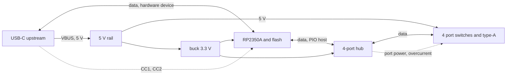

# crossfire hardware

The production board: an RP2350 hosting four USB instruments through a hub, with one USB-C
connector that carries both its power and its link to a computer.

**Status: prototype, nothing built.** Every number below is a budget or a datasheet figure, not a
measurement. A predecessor design exists elsewhere as a sketch of an earlier vision; it was never
manufactured or validated, so nothing here is inherited from it — individual parts are reused only
where they stand up on their own.

**This is the reduced first design.** An earlier revision of this board carried a Power Delivery
sink on a second connector, a charger and a cell, and a radio. Those are deferred, not rejected: they
made a first board that was hard to lay out and harder to bring up, and none of them is needed to
prove the thing the product is for. That revision is kept whole in the history at commit `bb66643`.

## What the board has to do

- Host four USB-MIDI instruments at once, on four type-A receptacles, each supplied from the
  board's 5 V input.
- Keep the firmware that already exists: the USB device role and its console, and the signed A/B
  image pair with probation.
- Present itself to a computer on the upstream connector *while* hosting the instruments, so the two
  roles live on separate interfaces.
- Take all of its power from that same upstream USB-C connector, and share out whatever the source
  there offers between the four ports and its own electronics.

## Three decisions shape everything else

### 1. Two USB roles on two interfaces

The RP2350 has **one** USB controller, and the board needs two roles at once: host for the four
instruments, device for the computer on the upstream connector. The roles are kept apart on separate
interfaces — the hardware controller takes one, and a full-speed port built in PIO takes the other.
Nothing is multiplexed and nothing switches role, so a computer and the instruments are live at the
same time.

**The hardware controller faces outward as the device, and PIO hosts the hub.** The deciding
argument is recovery, and it beats the alternative on its own terms:

- **The boot ROM drives the hardware controller.** Putting that pair on the upstream connector means
  BOOTSEL and USB DFU work on the connector the product actually has. Recovery needs no debug probe,
  no case opened, nobody on the bench.
- **It makes the risky new thing the recoverable one.** The host side is what has to be rebuilt, and
  if that goes wrong the board can still be reflashed over its own port. The other way round, a rough
  device port takes the console and DFU with it and leaves only SWD.
- **Bring-up starts working rather than blocked.** The board is programmable and has a console over
  its own connector before any of the new firmware exists, so the host side can be brought up
  incrementally against a board that already talks.

What it costs, plainly: **the host role moves onto a new transport.** The existing host stack sits
behind a host-controller seam, so the stack, the hub handling and the MIDI layer above it are kept —
but the packet-level transport underneath becomes a full-speed USB host built in PIO, which does not
exist in this tree. That is the single largest piece of new firmware this board asks for, and it is
the harder of the two roles to build: it has to generate frames, schedule transactions across four
devices and a hub, and handle retries.

The device side, by contrast, is already proven on hardware — the console rides it today. The one
addition there is the computer-facing MIDI interface, which is a device class on a working stack.

**The upstream connector is unambiguous.** It sinks power and acts as a device, both, always — so
the CC lines mean one thing, there is no role to choose, and the charger-versus-computer guess that a
multiplexed design would have needed is gone. Electrically it is also the simpler end: the hardware
controller's pins carry their own impedance matching and pull-ups, so the pair needs only an ESD
array and the receptacle's two data pairs tied together, so a cable can go in either way up.

**The PIO port sets the system clock, and it sets it upward: 240 MHz.** Full-speed bit timing off PIO
wants a system clock that is an integer multiple of 12 MHz, so the state-machine divider is exact and
the bit period carries no fractional jitter. The stock 150 MHz is not such a multiple. Going *down* to
120 MHz would satisfy it at the cost of a fifth of the loop; going up to 240 MHz satisfies it and buys
the loop instead, and four things line up on that number:

- **12 MHz × 20.** Twenty system cycles per bit, and an exact divide by two if the state machine wants
  to run at 120 MHz. Either way the divider is an integer.
- **Twenty cycles a bit is a generous instruction budget** for the hardest software on the board. Ten
  would have been tight. The clock that makes the timing legal also makes the program easier to write.
- **It is already proven on this silicon.** A board in this codebase runs RP2350 at 240 MHz today,
  from the crystal through a 1440 MHz VCO and a divide by six, at stock core voltage.
- **The flash stays at its fastest legal clock.** A 133 MHz part divided by two off 240 MHz is
  120 MHz. Higher multiples are worse here, not better: 288 MHz would need a divide by three and drop
  the flash to 96 MHz.

So the constraint that looked like a tax is a 1.6× clock increase, and the forwarding loop gets
faster rather than slower. The device port is unaffected either way — its 48 MHz comes from the other
PLL.

**It is an overclock, though, and that is the part to weigh.** 240 MHz is above the datasheet's
150 MHz. It is proven on the boards in hand; it is not characterised across a production population
or a temperature range, and a product ships into both. What to establish before committing: whether
stock core voltage still holds at temperature, and what the fallback is if it does not — 192 MHz
(12 × 16) is the next multiple down that still beats stock, and 120 MHz is the floor that always
works.

The PIO port is the host end, so it carries 27 Ω series resistors on the pair and host-side
pull-downs; the 1.5 kΩ pull-up belongs to the hub, which asserts it on its own upstream port. It runs
entirely on the board, from GPIOs to the hub, and never reaches a connector or a cable — which is the
kindest possible first home for a software-timed USB port.

One consequence of hosting on-board: **no host supplies VBUS to the hub's upstream port**, so the hub
is self-powered, and its upstream-detect input is driven by the MCU. The datasheet is explicit about
this case: a *detachable* hub divides that pin down from the upstream VBUS, but a self-powered hub
with a permanently attached host takes it "from a dedicated host control output, or the 3.3 V domain
that powers the host" — so a GPIO, which costs one pin and hands the firmware the ability to hold
the hub down until it is ready and to force a re-enumeration by toggling it. Without that pin
asserted the hub never believes it is connected.

### 2. One upstream connector, and its 5 V is the board's 5 V

Power and data arrive on **one USB-C receptacle**. Its data pair goes to the processor's hardware
controller, as above. Its VBUS *is* the 5 V rail: it feeds the four port switches directly and a
small buck converter that makes 3.3 V for everything else. There is no power path to manage, no
second source to keep apart from the first, and nothing between the connector and a port except that
port's own switch.

| | receptacle | carries |
| --- | --- | --- |
| upstream | type-C, USB 2.0, 16-pin | D+/D− to the hardware controller, Rd on both CC pins, ESD, VBUS as the 5 V rail |

**What that gives up is stated here rather than discovered later.**

- **The ports get what the cable delivers, not a regulated 5 V.** A source is allowed to be as low
  as 4.75 V at its own connector and a cable may drop half a volt more at 3 A, so a port can see
  about 4.2 V in the worst case with every port loaded through a poor cable. Class-compliant MIDI
  instruments draw a fraction of that current, where the drop is tens of millivolts, so this is a
  limit to state rather than one expected to bite.
- **The power available is 15 W at most**, because nothing on the board can ask for more than 5 V.
  That is exactly enough for four ports at full USB 2.0 current and the electronics, with about
  three quarters of an amp to spare.
- **A computer is now the power source as well as the host**, and most computers offer far less than
  3 A. That is what the third decision is about.
- **Nothing protects the rail from a source that misbehaves.** A compliant source stays at 5 V
  because this board never negotiates for anything else, and the port switches are 6 V parts. A
  charger that puts 9 V or more on VBUS unasked would damage them. That was a risk the earlier
  design's input switches removed; here it is accepted.

**The capacitance the source sees at plug-in is kept to what USB allows.** A device may present no
more than 10 µF to VBUS when it is attached. Everything permanently on the rail counts: the buck's
input capacitor, the bypass at each port switch, the one at the connector. That comes to 10.6 µF as
printed on the parts and noticeably less in circuit, since a 10 µF ceramic keeps perhaps two thirds
of itself at 5 V. Each port's 22 µF sits *behind* its switch, so it is charged through a current
limit when the hub turns that port on, not by the plug going in.

### 3. The source says what it can supply, and the firmware divides it

Four ports at full USB 2.0 current is 2 A, and the board itself takes about a quarter of an amp. A
USB-C source states how much it will supply through the CC line, and the three answers it can give
are very different budgets:

| the source advertises | the board takes | left for the four ports |
| --- | --- | --- |
| 3 A | 0.25 A | 2.75 A — every port at its full 500 mA |
| 1.5 A | 0.25 A | 1.25 A — four typical instruments, or two at full current |
| USB default (0.5 A, or 0.9 A on a USB 3 port) | 0.25 A | 0.25–0.65 A — one or two instruments |

**So the processor reads the CC lines, and port power is policy.** Each CC pin already carries the
5.1 kΩ that marks this board as a sink. The voltage the source's pull-up produces across that
resistor is the advertisement: under 0.61 V is the default, 0.70–1.16 V is 1.5 A, and 1.31–2.04 V
is 3 A. Both pins go to ADC inputs, each through 10 kΩ with 100 nF to ground at the pin, and the
firmware takes the higher of the two — the cable connects only one.

The firmware then decides which ports to power. The hub already switches each port's power on
request and reports over-current port by port, so enforcing a budget is a matter of which ports the
host stack turns on, using requests it already makes. The 1 A threshold in each port switch protects
the hardware; the policy decides what is offered.

**The sense must not load the line it reads.** A divider across CC would sit in parallel with the
5.1 kΩ and change what the source believes it is talking to, which is worse than not knowing the
answer. A series resistor into a capacitor draws nothing at DC, so the termination stays exactly
5.1 kΩ. That holds only while the processor's pad draws nothing either, which makes one firmware
requirement: **the digital input on those two pads stays disabled.** They are read by the ADC only.

## Block structure



*Solid lines carry power or USB data; dashed lines are control and sensing.*

## Power

### Rails

| rail | source | sized for | why |
| --- | --- | --- | --- |
| 5 V | the upstream connector's VBUS, directly | 3 A | the ports and the buck; whatever the source and the cable deliver |
| 3.3 V | fixed-output buck from 5 V | 2 A part, 0.35 A needed | a buck rather than a linear regulator saves about 80 mA of an input budget that can be as small as half an amp |
| 1.1 V (core) | the MCU's own switching regulator | — | not a board converter, but it needs board parts: an inductor on `VREG_LX` and a feedback network, which is why it is a rail and not just decoupling |

The core rail catches people out, so it is worth stating: this MCU regulates its own core with a
*switching* regulator, not a linear one. It brings out `VREG_VIN`, `VREG_LX` and `VREG_FB`, so the
schematic carries an inductor and the rail it makes feeds the `DVDD` pins. The analogue supply for
the ADC wants its own filter off 3.3 V as well, and it now has work to do: the two CC readings come
through it.

**The 3.3 V converter is a fixed-output part, so it has no divider to get wrong.** It takes an input
capacitor, a bootstrap capacitor, an inductor and its output capacitors, and its enable is tied to
its input so it starts when the cable goes in. Its input range reaches well above anything VBUS
should carry and down to 3.8 V, which is below the lowest the cable can leave it with.

### Budget

**3.3 V rail**

| | typical | peak |
| --- | --- | --- |
| RP2350A, both cores at 240 MHz, USB active | 110 mA | 150 mA |
| QSPI flash, executing in place | 15 mA | 25 mA |
| hub | 90 mA | 120 mA |
| indicators, crystals, pull-ups | 25 mA | 40 mA |
| **total** | **240 mA** (0.79 W) | **335 mA** (1.1 W) |

At about 90% conversion that is **175 mA typical and 250 mA peak from the 5 V input**.

**5 V rail**

| | current | power |
| --- | --- | --- |
| full USB 2.0 spec, 4 × 500 mA | 2.00 A | 10.0 W |
| four typical MIDI instruments | 0.4–1.0 A | 2–5 W |
| the 3.3 V converter's input | 0.18–0.25 A | 0.9–1.25 W |

**Upstream**

Worst case is 2.25 A at 5 V, which a 3 A source covers with margin. A 1.5 A source runs four
ordinary instruments. A default port runs the board and one or two instruments, and it is the
firmware's reading of CC that tells those three cases apart.

## Parts

Stock KiCad symbols exist for everything marked with one; the rest need drawing.

| block | part | symbol | why |
| --- | --- | --- | --- |
| MCU | RP2350A, QFN-60 | `MCU_RaspberryPi:RP2350A` | 30 GPIO is enough (see below); RP2350B if a display is added |
| flash | W25Q128JVS, 16 MB | `Memory_Flash:W25Q128JVS` | the A/B image pair plus the asset partition; 2 MB would not hold it, and its 133 MHz rating covers the 120 MHz the divider lands on |
| hub | USB2514B | `Interface_USB:USB2514B_Bi` | four downstream ports, per-port power and overcurrent pins, no external EEPROM needed |
| port switch ×4 | TPS2065C | `Power_Management:TPS2065CDBV` | 1 A threshold, **active-high enable, open-drain fault** — what the hub needs at both ends. It limits by going into constant current rather than latching off, and adds reverse blocking and output discharge, both of which a port wants. Its 0.5 A sibling is the same trap as before: that is the budget itself, with nothing for inrush |
| port data ESD ×4 | 2-channel array, low capacitance | — | needed because the switch above protects power only. The TPD3S0x4 would have covered both, but it has no fault output, so it cannot tell the hub anything |
| 3.3 V | AP63203WU | `Regulator_Switching:AP63203WU` | fixed 3.3 V, 2 A, input to 32 V and down to 3.8 V; no feedback divider, six pins |
| upstream data ESD | 2-channel array, low capacitance | — | the downstream pairs get theirs from the port switch; the upstream pair has no such part in front of it |
| upstream connector | USB-C 2.0, 16-pin | `Connector:USB_C_Receptacle_USB2.0_16P` | power and data both |
| CC sense ×2 | 10 kΩ and 100 nF | `Device:R_Small`, `Device:C_Small` | one pair per CC pin, into an ADC input; in series, so the 5.1 kΩ termination is not loaded |
| port connectors ×4 | type-A | `Connector:USB_A` | |

Two notes on the hub. Its upstream link runs at full speed, because the RP2350's controller is
full-speed only — so the whole tree is full speed and instruments that could do high speed fall
back, which costs nothing, as USB-MIDI 1.0 is a full-speed class. And the hub drives the port
switches itself: `PRTPWR[1:4]` to each switch's enable, each switch's fault back to `OCS_N[1:4]`. Port
power then goes on and off through ordinary hub requests that any host stack already makes,
overcurrent arrives as a standard port status change, and eight GPIOs stay free.

### Passives

A value on its own is not a specification, so every capacitor carries a **voltage rating and a
dielectric**, chosen from the net it sits on rather than from a house default. The rule is at least
twice the working voltage, rounded to a standard rating, and never below what a socket the user can
reach is able to present.

| what it decouples | rating | dielectric |
| --- | --- | --- |
| 3.3 V, the bootstrap and the internal filter nodes | 16 V | X7R |
| the core rail and the regulator's own capacitors (1.1 V and 3.3 V, 4.7 uF in 0402) | **6.3 V** | X5R |
| the 5 V rail and each port's own output | 25 V | X7R |
| the connector side — the capacitor at the receptacle and the two on the CC senses | **50 V** | X7R |
| crystal loads | 50 V | **C0G** |

**The 5 V rail is now a connector-side rail**, since nothing stands between it and the receptacle.
Its capacitors are rated 25 V for that reason and not because 5 V asks for it.

**Resistors carry a tolerance, and it is 1% only where the value is read**: a reference a part
trims itself against, a divider ratio, a termination that states what this end of a cable is. The
rest are pull-ups, pull-downs, straps and series parts, where 5% is honest and 1% is a cost with
nothing on the other side of it. Power is not a field: the largest dissipation anywhere on the
board is a few milliwatts in an indicator's series resistor, so the smallest standard part covers
every one of them.

**The two inductors are specified by what they have to carry, not by their value alone.**

| | value | has to stay unsaturated to | why that number |
| --- | --- | --- | --- |
| core regulator | 3.3 uH +/-20% | **1.5 A** | the processor's own datasheet says so, along with a 250 mohm ceiling on resistance |
| 3.3 V buck | 4.7 uH | **2 A** | the load is a third of an amp, but the converter limits at well over 2 A and the inductor should not be what gives way first |

**The core regulator's inductor has a requirement that is easy to lose**: it must be fully shielded
and **marked for polarity**, and oriented the way the vendor's layout shows. Their own note is that
stray field from the inductor couples into the regulator's control loop and moves the output even
with nominally shielded parts. That is a placement constraint arriving from a component datasheet,
so it is recorded here where layout will look for it.

**The crystals are specified by load, not just frequency**, because the load is what decides
whether they oscillate on frequency at all. Both work out at **10 pF**, and both vendors name the
arithmetic rather than leaving it to be guessed.

The processor's is simply stated: its vendor recommends a specific part and publishes its
parameters, 10 pF load and +/-30 ppm either side. The hub's has to be derived, and the derivation
is the part worth writing down, because the obvious way to do it is wrong. Stray capacitance sits
in parallel with **each** loading capacitor, not with the two of them in series -- so the load is
not half the pair plus the stray, it is half of *(the pair plus the stray)*. With the 18 pF the
hub's own documents call typical and a few picofarads of board stray, that is about **10.5 pF**,
and the nearest standard part is 10 pF. The naive arithmetic gives 12 pF, which is a different
part. Both of the vendor's two formulations -- the older datasheet's and the newer checklist's --
agree on this once they are read carefully.

Its frequency allowance is **+/-350 ppm**, and that number is a trap in the other direction: it is
the *total* the hub can tolerate, so a part sold as +/-350 ppm would spend the entire budget before
temperature and ageing are counted. A commodity +/-50 ppm part meets it several times over.

**There is no feedback resistor across either crystal, and none is wanted.** The hub's datasheet
figure draws a 1 Mohm across the pins without saying which side of the package it is on; its
design checklist, which exists to list what the board has to provide, asks only for the two
loading capacitors. The same checklist confirms two things already drawn: the 12.0 kohm 1%
reference to ground, and that the reset line may be held by the processor rather than pulled up,
which is what the pull-down and the GPIO on it amount to.

### Mechanical, and the connectors

**The enclosure is drawn around the board, not the board around an enclosure**, and the first one
runs bare on a bench. That ordering decides more than it sounds like: the board may take whatever
outline suits it, but it has to be usable with nothing around it, so parts that are pressed or
looked at face upwards rather than sideways, and anything that takes a plug's insertion force goes
through the board rather than resting on pads.

**One constraint fixes the board's width, and it is the port pitch.** Four type-A receptacles at
**25.4 mm between centres** span 76.2 mm centre to centre. The widest stock footprint for a
full-size horizontal receptacle occupies 22.8 mm and the narrowest 15.4 mm, so every one of them
fits the pitch -- the narrow end leaving about 10 mm of clear board between neighbours, which is
where each port's switch, its protection array and its bulk capacitor have to live. Taking the
narrow one, the four ports occupy 91.6 mm of courtyard, and with a few millimetres of edge each
side **the port edge cannot be shorter than about 100 mm**. That is now a fixed dimension of the
product, not an outcome of layout.

It is worth recording *why* 25.4 mm rather than something tighter, because it looks generous
against a 13 mm receptacle and invites being trimmed later. The number is not about the
receptacle, it is about the **plug**: a moulded type-A plug is commonly 16 to 20 mm across, so a
narrower pitch yields a hub whose four ports cannot all be used at once. That is the failure this
product exists to avoid.

| | part | why |
| --- | --- | --- |
| downstream ports x4 | full-size type-A, horizontal, **through-hole** | the plug's force goes into the board. Every stock option is through-hole, which settles it |
| upstream | 16-pin type-C, surface pads with **through-hole shell tabs** | the signal pads are fine surface mount; the shell takes the strain through the board |
| indicators | 0603, **red and green** | the 1 kohm series resistor rules out the high-voltage colours |
| buttons x3 | 6 mm surface-mount tactile, top-actuated | one part for all three, pressable on a bare board |
| debug | 5-pin header on 2.54 mm | bench-first means a header that any probe's flying leads reach |

**The indicators' series resistor has already chosen their colour, which is worth noticing before
someone fits a blue one.** They run from a 3.3 V pin through 1 kohm, so the current depends entirely
on the forward voltage: about **1.3 mA** for red, amber or ordinary green, and about **0.3 mA** for
true green, blue or white, which is not enough to rely on seeing. The low-voltage colours are
therefore not a preference here, they are a requirement of the resistor already drawn. Taken as
**red and green**; swapping to blue or white means changing the resistor too, and at that supply
there is very little headroom left to do it with.

1.3 mA is deliberately modest rather than accidental -- a modern part is clearly visible at it
indoors, and on a source that may offer half an amp it is not worth spending more.

**The three buttons are one part, surface mount, top-actuated, at the edge.** One line item covers
all three, a 6 mm actuator is comfortable to press on a bare board, and an enclosure then wants a
hole rather than a plunger. Two notes for whoever draws that enclosure: the user button is the only
one an owner should be able to reach, since the other two put the board into its bootloader and
reset it, so recessing them is reasonable even though all three sit on the same edge. And the user
button has **no pull-up on the board** -- it relies on the processor's internal one being enabled,
which is ordinary, but it means the pin reads as floating until firmware has configured it.

**Four M3 mounting holes, plated and bonded to ground.** Bonded rather than bare because the
asymmetry favours it: five connector shells on this board are already at ground, so if the enclosure
is metal a screw into a metal standoff should join that system deliberately rather than through
whatever it happens to touch, and if the enclosure is plastic the bond does nothing and costs
nothing. The decision that cannot be undone without a new board is the one to leave the pads off.

**Two go in the back corners and two go between the sockets.** Each needs about 7 mm of clear
diameter, because an M3 head is 5.5 mm and a washer 7 mm, and a hole only the drill clears is one
that cannot be done up. The gap between one socket's body and the next is 8.1 mm, which takes a hole
with half a millimetre to spare each side -- so the front pair sit in the first and third gaps,
under 4 mm from the front edge, right where a plug is pushed in. That is better than the earlier
arrangement could manage, where nothing came within 16 mm of the socket row and the enclosure had to
carry it on a ledge.

| | position | |
| --- | --- | --- |
| H1 | 4.0, 4.0 | back left corner |
| H2 | 96.2, 3.8 | back right corner, beside the buttons |
| H3 | 24.6, 49.5 | between the first and second sockets |
| H4 | 75.4, 49.5 | between the third and fourth |

**Each capacitor's package is chosen from how much of it has to survive its own bias.** The
question is not how much capacitance is printed on the part but how much is there once the voltage
is across it. On this board the question has an upper bound as well as a lower one: the 10 uF at the
buck's input is in 0603, which keeps enough of itself at 5 V for the converter and loses enough to
stay inside what USB allows a device to present at attach. The 22 uF parts at the 3.3 V output are
in 0603 too, on a 3.3 V rail they are a long way up their own curves; the ones at each port are
1206. Decoupling goes to 0402, where being close to the pin matters more than the package.

**The processor's regulator takes the vendor's parts, not ours.** Its own hardware design guide
puts 4.7 uF in **0402** on the regulator's input (`VREG_VIN`), on its output (the core rail), and
on its analogue supply -- and the analogue supply is fed through **33 ohms** from 3.3 V, because
"the VREG_AVDD supply is very sensitive to noise, and therefore needs to be filtered" and draws
only about 200 uA. This board had the input and output capacitors as 10 uF and 4.7 uF in 0805, and
no filter at all. All three are now as the vendor has them (C4, C17, and R9 with C15), which also
takes two parts from 3.5 x 2 mm down to 1.9 x 1 mm beside the pin field, which is where there was
no room. The filter is 100 ohms and 1 uF rather than the vendor's 33 ohms and 4.7 uF: the same
corner frequency, 20 mV of drop at 200 uA, and a capacitor that exists in 0402 at 6.3 V -- and it
sits outside the regulator's loop, because at 200 uA the few millimetres of track from the pin to
the filter cost nothing. The same guide accepts one 100 nF shared between `USB_OTP_VDD` and `QSPI_IOVDD` for the
same reason, and places the boot button's resistor at the flash.

### Footprints

**Every part carries a footprint.** Most are decided the moment the part is -- a SOT-23-5 is a
SOT-23-5 -- and the capacitors' came out of the reasoning above. The resistors are all 0402. They
were 0603, on the argument that the first board runs bare on a bench and a part you can get a probe
or an iron onto is worth the millimetre; beside two fine-pitch parts the millimetre turned out to be
worth more. Nothing electrical changes: the largest dissipation in any of them is a few milliwatts
against a sixteenth of a watt. The two indicators stay 0603, since they are there to be seen.

**A footprint chosen by body size and pin count is not checked.** The hub's was wrong by 0.2 mm in
each direction when it was picked that way. Its datasheet tabulates a **recommended** land pattern,
not merely a package outline, and names a 3.70 mm pad where the provisional entry had 3.90. Too
large is the direction that floats a part off its pins on reflow. Neither error of that kind shows
in the schematic, the connection list or any rules check -- only on a board that does not assemble
properly -- and the drawings that settle it are graphics with no text to extract, so they have to be
rendered and read rather than searched.

**Two footprints come from the processor vendor's own reference design**, which is published under
a permissive licence and carried into this project's footprint library with the notice that licence
asks for. One is the core inductor's. The other is the **processor's own land pattern**: the pad
under that part is the pattern its maker lays out, not a guess at the nearest library variant.

| | part | why |
| --- | --- | --- |
| core regulator inductor | Abracon AOTA-B201610S3R3-101-T | the processor's vendor names it, and publishes a layout built around it |
| 3.3 V buck inductor | a 4.7 uH part in the 4 mm shielded family already on the board | the land pattern was already in the project; the exact part number is still to be confirmed against its saturation figure |

**The board carries its name on the front silkscreen**: the application's graphic, 21 x 15.5 mm
in the open area right of the hub, with `CROSSFIRE Rev ${REVISION}` beneath it, the revision read
from the board's title block so a new revision is one field change. The graphic is a footprint in
the project library, `crossfire_logo`, traced from `art/crossfire-logo.png` by
`scripts/png2silk.py`: ink thickened at full resolution so the thinnest stroke prints at 0.2 mm,
then scaled to 0.1 mm pixels and written as filled rectangles. Regenerate it from the script, not
by hand, if the artwork changes.

**The socket's and the receptacle's footprints are project copies of the library's**, differing
only in their silkscreen.
The library draws the whole body, including the 3.7 mm that stands beyond the board edge, and the
rules check reports every silk line that crosses the edge. The copy stops its silkscreen 0.4 mm
inside the edge marking; pads, courtyard and fabrication drawing are the library's.

### GPIO budget

Twelve of the thirty, and the assignment is not arbitrary — the PIO pair is forced adjacent and the
rest fall out of keeping peripherals on their default pins.

| GPIO | net | why there |
| --- | --- | --- |
| 0, 1 | `CONSOLE_TX`, `CONSOLE_RX` | UART0's default pair |
| 2, 3 | — | spare |
| 4, 5, 6 | — | spare; 4 and 5 are I²C0's default pair, kept free for the power parts when they return |
| 7 | `HUB_RESET` | |
| 8, 9 | `PIO_D+`, `PIO_D-` | **forced adjacent**, low pin first — the PIO program addresses the pair as a base and an offset |
| 10–13 | — | spare; the four a radio would take, 12 and 13 adjacent for its clock and data |
| 14, 15 | `LED_1`, `LED_2` | |
| 16 | `BUTTON` | |
| 17 | `VBUS_DET` | VBUS present, divided down |
| 18 | `HUB_VBUS_DET` | tells the hub its upstream is live; also the way to force a re-enumeration |
| 19–25 | — | spare, and still contiguous: seven in a row is a display bus |
| 26, 27 | `CC1_SENSE`, `CC2_SENSE` | ADC inputs: what the source advertises |
| 28, 29 | — | spare, and the last two that reach the ADC on this package |

Dedicated pins take the rest: QSPI to the flash, the hardware USB pair to the upstream receptacle, SWD to
the debug header, XIN/XOUT to the 12 MHz crystal, RUN to reset.

The boot button is not a GPIO. It pulls the flash's chip select low, the way the reference design
does, so it costs nothing from the budget above — and the button on GPIO 16 is a separate, ordinary
one.

## The board

**Four layers**, with the two inner ones named for what they are: a ground plane and a power
plane. Two would have been possible -- the processor's own vendor escapes this exact package on
two -- but their reference board has no hub. This one has six signal pairs wanting a continuous
reference, two switching regulators wanting a solid return, a 3 A rail crossing the whole board from
the upstream connector to four sockets on the opposite edge, and a 0.4 mm pitch sixty-pin package
sitting next to a thirty-six-pin one. With the charger and the radio gone the case for four is
weaker than it was, and it is still the cheaper answer than finding out on a two-layer board.

**No controlled impedance, and that is a decision rather than an omission.** Every port on this
board runs at full speed, because the processor's own controller is full-speed only and the hub
therefore presents a full-speed tree. At twelve megabits a hundred millimetres of track is
electrically short, and the 90 ohm figure the USB specification quotes is a property of the cable,
not of the board. The pairs still get a class of their own -- routed together, over unbroken
ground, lengths loosely matched -- but the fab needs no impedance option, which is a real saving on
a four-layer board.

**The rules come from a board that is known to work with this processor.** Its vendor's reference
design uses 0.15 mm minimum track, 0.15 mm clearance and a 0.5 mm via on a 0.25 mm drill -- and
escapes the sixty-pin package with them on *two* layers. Taking the same numbers on four leaves
margin rather than demanding a finer process, and they are ordinary enough that no fabricator
charges extra for them. Two of the figures were set higher than that at first, and the parts
rejected both:

* **Clearance is 0.15 mm, uniformly, including on the power classes.** The processor's pads are on
  0.4 mm pitch and 0.23 mm across, so the gap between one pad and the next is 0.17 mm. That is a
  property of the package, and no rule above it can be satisfied by *any* board carrying the part.
  A class clearance is a routing figure -- how much air to leave between tracks -- and a pad field
  cannot honour one. Nothing is given away by lowering it: IPC-2221 asks 0.1 mm between uncoated
  external conductors below 30 V, and the highest potential anywhere on this board is the 5 V
  input. The heavy rails still get more room than the floor wherever the layout allows; what
  changed is that this is a layout practice rather than a rule the parts break.
* **The smallest hole is 0.2 mm**, not 0.25, and the smallest via 0.4 mm across. That is what
  lets a via sit under a fine-pitch part's wider pads. Through 1.6 mm of board it is an 8:1 aspect
  ratio, which is ordinary capability rather than a special request, though worth confirming with
  the fabricator chosen.

**The net classes are sized from the current each rail carries**, not left at a default. External
copper at one ounce and a ten degree rise carries roughly an amp in 0.3 mm, two in 0.8 mm, three in
1.4 mm and five in 2.8 mm, which gives:

| class | width | what it carries |
| --- | --- | --- |
| Default | 0.20 mm | everything carrying information rather than current |
| USB | 0.25 mm | the six pairs, as pairs |
| Power | 0.50 mm | up to an amp: the logic rails, one port's output |
| Power+ | 1.00 mm | two to three amps: the 5 V rail, from the upstream connector to the ports |

The heavy rails are expected to end up as poured copper rather than track, so that last width
is the floor for any stub that *is* tracked, not a plan for how the current gets there. There is no
separate signal class: the default *is* the signal class, which is one fewer thing to keep in step.

**The outline is 100 x 49.8 mm** with 1.5 mm corners. The 100 is not a choice -- it is what four
receptacles at 25.4 mm centres plus edge margin come to. The depth is 18 mm for the sockets with
their switches behind them, one row of everything else behind that, and ten millimetres behind
*that* for the signals to run in: the board was 44 for a while, every part fitted, and the lines
between the parts did not. It was 80 with the charger, the cell's connector and the radio on board,
and 54 until the sockets were set to overhang. **The sockets overhang the front edge by 3.7 mm**:
the receptacle's footprint carries a line marking where the board edge belongs, with the plug
opening standing proud of it so a panel can sit flush against the socket face, and the edge is cut
exactly on that line. The corners were 3 mm until the outer two receptacles were placed: a 3 mm
radius cuts across the corner far enough to reach their shield pads, so the radius is set by the
parts nearest the corners rather than by taste.

**The board is designed at the origin and placed on the sheet last**, and those are deliberately two
different things. Designing at the origin is what makes every position here readable -- a part at
(17, 50) is seventeen millimetres from the left edge of the *board*, which is a fact about the
product. The sheet is not: its frame is inset ten millimetres from the paper and its title block
takes the bottom right of that, so a board left at the paper origin sits across the frame line in the
corner with the border running through it.

The last pass moves the whole design -- every footprint, track, via, pour, graphic and the outline --
as one rigid piece onto the sheet, centred across the page and clear of the title block. Nothing
moves relative to anything else, so no placement and no clearance can change. The offset is measured
from where the outline actually is rather than stored, so the pass can be run again without walking
the board off the page.

One real change came out of it. Refilling the pours at a new position left a few slivers of copper
with no connection to their own net, which the check reported as isolated copper. The pours now have
island removal turned on, which they should have had: floating metal is worse than no metal. It costs
3.2% of the 3.3 V plane and nothing measurable on the others, and what it removes is copper that was
carrying nothing.

### Layout

**Every part is placed and every net is routed.** The passives were placed and their own
connections drawn by rule; the pairs, the buses and the rest were routed by hand afterwards, and the
ground stitching went down last. The division is deliberate: what a rule decides is done by the
rule, and what wants a person is done by one.

The floor plan is one row behind the sockets, read left to right in the order the signals flow:

| | what | why there |
| --- | --- | --- |
| left edge | the upstream connector, facing left, with its protection array behind it | one cable out of the side, away from the four at the front |
| top left | the 3.3 V converter, its inductor and capacitors | beside the connector whose 5 V it takes |
| centre left | the processor **turned a half turn**, its crystal above it and its flash below it | turned, its flash and USB pins face down to the flash and the connector's pair, its host pair faces the hub, its crystal and the debug, reset, button and indicator pins face the back edge, and its two ADC pins face the connector's CC senses |
| centre right | the hub, turned a quarter turn, **level with the processor's host pair** | turned, its upstream pins and crystal face the processor and its four downstream pairs face the sockets; raised so the host pair is one straight run across the gap |
| top right | three buttons along the back edge, the debug header below them, the indicators at the right edge | where a hand reaches them on a bare board |
| front | four sockets, each with its switch, its bypass and its bulk capacitor directly behind it, and its protection array on the back under its pins | |

**The turns are the plan.** Each part's pins are grouped by function along its four sides, and
with both parts square to the board every important group faced the wrong neighbour. Turned, the
host pair is one straight run across the gap from processor to hub with nothing in it, the flash
sits under the pins that talk to it, the crystal under its own, the upstream pair drops off the
bottom row and runs left to the connector, and the four downstream pairs leave the hub already
pointing at the sockets. The cost is the back edge: the crystal sits where the debug, reset, button
and indicator pins come out, so those slow lines go under it on the back layer for their first few
millimetres.

**The second inner layer is split where the current runs.** 5 V takes a strip down the left edge,
under the connector and the converter's input, and the whole band under the sockets, so the 3 A
from the connector to the port switches is carried by a plane and no track. 3.3 V takes the rest.

Sixty-two passives were then placed one at a time in order of importance, each at the nearest
position from which its own connections could actually be drawn, and drawn there: crystals and the
core regulator first, then the converter's loop, the input and port bypasses, one decoupling
capacitor to each supply pin, and last the parts that carry no current.

**"Nearest" is not nearest to the pin; it is nearest without standing in a neighbour's way.** The
first attempt put every decoupling capacitor hard against its pin, which is what every layout note
says to do, and walled both fine-pitch parts in: the signal pins between the capacitors had nowhere
to go. So every used signal pin on the part a capacitor serves owns the strip of board straight out
from it, two millimetres or so, far enough for a track to get clear of the pin field. A position is
charged for each strip the capacitor's body would cross, more the closer to the pin, and the
capacitor settles where that charge is least: beside an unused pin, at a corner, or a little further
out. That alone was not enough -- half of them still sat against the package, beside pins that
happened to be unused -- so each fine-pitch part also keeps a ring 0.9 mm wide round its body that
no other part may enter. The exception is a part that exists to sit at one pin -- the hub's bias
resistor and its two filter capacitors -- which goes inside the ring and goes down first, before the
crystal; kept out, those three landed five millimetres away and could not get back in. And every
group of signals has a strip of its own that no part may enter:
the upstream pair, the CC senses, the flash bus, the host pair, the debug and button lines up to the
back edge, and the four downstream pairs down to their sockets. The decoupling capacitors ended up
1.6 to 6 mm from their pins, joined at 0.4 mm rather than at the rail's width, since a wide track
beside a pin row is a wall of its own. Two small parts are placed but not connected: the hub's bias
resistor and the VBUS sense divider.

The first layout taught the method, and it carries over even though the parts it was learned on do
not. The record of how each rule was arrived at is in the history with that design; the rules
themselves:

* **Place and route in order of importance.** A part is not placed until everything more important
  than it is both down and connected, and it goes only where its own connections can be drawn.
  Placing everything and routing afterwards asks the last question first.
* **A converter's loop capacitors go down before its inductor**, against the pins, and the inductor
  before any signal. The loops that matter run capacitor to switch and back; the inductor is in
  neither, and can give way.
* **Every signal pin on a fine-pitch part keeps its escape, and the capacitors go round it.**
  Capacitors placed with only body clearance wall the signal pins in; a capacitor a millimetre
  further out costs the loop almost nothing and the signals everything.
* **Ground goes down through a via at the pad.** A ground track is drawn only where a loop is being
  closed on the surface; anywhere else it is copper the pour would have supplied, except that the
  pour gives way to a signal and a track does not.
* **The via is beside the pad, not in it, and it is 0.6 mm on a 0.3 mm hole.** The board was laid
  out the other way -- a 0.4 mm via on a 0.2 mm hole inside each capacitor pad, which takes no room
  and makes the shortest loop there is -- on the condition that the fabricator fills and caps the
  holes, since an open hole in a reflowed pad draws solder down the barrel. The quote put a price
  on that condition, and on the 0.2 mm hole itself, that a prototype does not carry. So the vias
  came out of the pads: each sits just beyond its pad's outer end on a 0.3 mm stub, or shares a
  neighbour's, which is the layout the first rule above was trying to avoid and costs the room it
  saved. Most of that move was done by a script that tested every candidate position against the
  board's own geometry; the rest, where capacitors sit between pins or vias sit between pads, by
  hand. Blind vias would free a little of the back face and are not worth a second lamination;
  buried vias free nothing on the surface at all.
* **A pour must join at least two things**, and a track is used wherever a track fits.
* **Stitching comes after routing, and on a grid.** A stitching via placed first is in a track's
  way, so the two outer pours are tied to the plane only once every net is in: a 0.6 mm via on a
  6 mm grid wherever both faces have pour at that point, placed only where the fill actually is and
  clear of every other net. Then every piece of pour that would still float gets a via of its own,
  and where that piece is nothing but a ground pad's own copper, the via goes in the pad.
* **A short run is sized by its resistance**, not by a width table: a class width states what the
  run carries, and the escape from a narrow pin is necked to the pin.
* **A connector is checked for which way it faces**, by a person, because no rule check tests
  whether a socket opens toward the edge.
* **A rules check that passes proves clearance, not adequacy.** A switch node routed clean at a
  fifth of a millimetre is clean and wrong.

## Sheets

| sheet | contents |
| --- | --- |
| `mcu` | RP2350A, flash, crystal, SWD, boot button, decoupling, and the two ADC inputs that read CC |
| `upstream_data` | the upstream receptacle, Rd on both CC pins and the sense behind each, ESD on the hardware USB pair, VBUS sense, and VBUS leaving as the 5 V rail |
| `hub` | USB2514B, its 24 MHz crystal, the `RBIAS` resistor, the PIO host pair's series resistors and pull-downs, upstream detect from the MCU, and four downstream pairs |
| `port` | one port: switch, ESD array, receptacle, bulk capacitance — instanced four times |
| `power` | the 3.3 V buck with its capacitors and inductor, and one bypass capacitor for each port switch's input |

## The project as it stands

`crossfire.kicad_pro` is a KiCad 10 project holding the root sheet and five child sheets, one of
them placed four times. The root carries the decomposition and the interface: every sheet has its
pins, every pin has a matching hierarchical label inside its sheet, and every pin carries a named
stub, so each net that crosses a block boundary is named and agreed. `port.kicad_sch` is drawn once
and instanced four times, with the root mapping its generic `D+`/`D-`/`PWR_EN`/`FAULT` onto the
hub's `Pn_*`. The two rails are carried on power symbols, so the `power` sheet has no pins at all.

**Differential pairs are named so the layout tool sees them as pairs.** It recognises a pair by its
suffix: two names identical up to a final `+` and `-`. The USB specification's own `DP` and `DM` are
not recognised, and neither is a generated name that ends in a bracket, so every stretch of every
pair carries a label -- including the stretches between a protection array and its connector, and
between the hub and its series resistors.

Both are drawn the way a person would draw them: **signals are wires**, and only the rails and the
nets that leave the sheet are carried on symbols and labels. Parts sit beside the pins they serve —
the flash is placed so all six lines of its bus are single straight segments across to the MCU, and
on the hub every passive is turned side-on so it sits in line with its own pin. That last one is
what keeps a chip with fourteen left-hand pins from becoming a knot: each pin owns a row, and
nothing has to cross anything.

**A sheet placed more than once needs care that a sheet placed once does not.** `port` is drawn
once and used four times, and each placement is a real set of parts with its own references. KiCad
carries that inside the symbol: one instance path per placement, each naming the reference that
placement uses. A symbol carrying a single path — which is all a sheet used once ever needs — leaves
the other three placements with no parts in them at all. Worth knowing before drawing any other
repeated sheet, and worth checking by reading the netlist rather than the drawing: the four
placements should name twelve different parts, not three.

It can all be checked without opening the editor:

```
kicad-cli sch erc      -o erc.rpt crossfire.kicad_sch
kicad-cli sch export netlist -o crossfire.net crossfire.kicad_sch
```

The netlist is real: 92 parts on 77 nets, and every one of the twenty-three unconnected pins is
deliberate — the sixteen spare GPIOs the pin map names, the three hub pins the datasheet says to
leave alone, the receptacle's two sideband pins, and two more ADC inputs. Read it rather than the
picture when checking a sheet; a wire that looks right and a wire that *is* right are not the same
thing, and the netlist is the one that answers. That is not a figure of speech here: the earlier
3.3 V converter's feedback divider crossed its feedback wire without a junction and was drawn
connected for the whole life of that design, and only the netlist said otherwise.

ERC reports five things and all five are understood. Four are the hub's over-current inputs, which
are driven by open-drain fault outputs against the hub's internal pull-ups, an arrangement the check
has no way to recognise. The fifth is a note that the flash's embedded symbol differs from the
library's current copy.

## Settled since

**Four things the reference documents asked for that the schematic did not have.** A pre-fab pass
against the processor vendor's hardware design guide and the hub vendor's design checklists, read
rather than remembered, found them; no rules check could. The processor's hardware USB pair
"require 27 Ω series termination resistors, placed close to the chip" -- the only 27 Ω pair on the
board was on the PIO host lines -- so R21 and R22 now sit between pins 51 and 52 and the
protection array, and the chip-side stubs are named `MCU_D+`/`MCU_D-` so the layout tool routes
them as a pair. The guide's crystal circuit has a 1 kΩ in series with XOUT to keep the crystal from
being over-driven at 3.3 V, and says any deviation "will require extensive testing"; R23 is that
resistor, on the chip side of the crystal node. The hub's two non-removable straps were left
unconnected, and its checklist says they "have no internal terminations and must be terminated":
R24 and R25 pull them to ground, which reads as four removable ports. And the hub checklist wants a
capacitor at each of its four analogue supply pins where one had none, so C45 joins the hub's
3.3 V row, with C43 and C44 added for the processor's third DVDD pin and sixth IOVDD pin, which
had been sharing. What the same reading confirmed is recorded above: the straps select the default
self-powered mode with per-port switching, the over-current inputs have internal pull-ups, the
filter pins want no more than 100 nF, and 150 µF on a port is a ceiling, not a floor.

**The sockets overhang the front edge.** The receptacle footprint marks where the board edge
belongs, 3.7 mm behind the socket face, and the board was cut flush with the socket face instead,
so a panel could never sit against the sockets. Every part was moved behind the marking and the
front edge trimmed to it: the board is 49.8 mm deep now, not 54, and the bottom row of stitching
vias went with the strip.

**The board is reduced to one USB-C input.** The Power Delivery sink and its connector, the charger
and the cell, the two input switches and the ship switch, the 5 V boost, the 3.3 V buck-boost and
the radio are all off the board. What replaced them is VBUS taken straight to the port switches and
to a fixed 3.3 V buck: eleven parts where there were seventy-two. The reason is not that any of them
was wrong. Together they made a first board whose power section could not be routed on four layers
as placed, with three switching converters, a seven-amp inductor and a fine-pitch charger competing
for the same few square centimetres, and none of that is needed to prove a PIO host carrying four
instruments through a hub -- which is the part of the product with nothing behind it yet.

**Which brings the CC senses back, for the opposite reason they left.** They came off when the data
port's contribution was capped by intent, so that knowing what its source offered bought nothing.
The data port is now the only source, what it offers is the whole budget, and the range is sixfold.
The objection that removed them still shapes how they are drawn: nothing may sit across the
termination resistor, so each sense is a series resistor into a capacitor and not a divider.

**The host stack's seam carries a PIO transport.** This was the first thing to establish and it
holds up. The stack is written against a `HostController` trait of eight methods — device detect,
root-port reset, control, bulk in, bulk out, and interrupt-pipe allocation — and everything above it
is generic over that trait, including the enumeration and the hub handling. It already has three
implementations, two chips and a mock, and the mock is the proof: the stack has been substituted
before. So the enumeration, the hub handling and the MIDI layer are all kept, and only the transport
underneath is new.

What that does *not* buy is a smaller job. The chip implementation is about 1,600 lines, and it
divides in two. The transfer-level half — splitting transfers into packets, reassembling them, pipe
bookkeeping — carries over in shape. The other half is register writes that ask the silicon to
generate frame markers and keep-alive, and to do CRC, bit stuffing, encoding and retries. **A PIO
transport has to supply all of that in software**, on a one-millisecond frame cadence and inside the
bus turnaround window. The seam being clean means the work is contained, not that it is small.

**The hub needs no EEPROM, and its defaults are already what this design wants.** Its configuration
register 06h powers up at 9Bh, and that value decodes to self-powered operation, over-current
sensing on a port-by-port basis, and port power switching on a port-by-port basis — the three things
this design depends on, all of them the factory default. An EEPROM or an SMBus master would only be
needed to change them, or to give the hub custom identifiers.

The same register answers the speed question. Its high-speed-disable bit is clear by default, which
means the part attaches as high- *or* full-speed, whichever the host offers; a full-speed host gets a
full-speed hub, and no configuration is required to make that happen. The bit exists to force
full-speed only, which is worth knowing about but not worth an EEPROM to set.

Two details that came out of the same reading and would have been found the hard way: the
over-current inputs carry internal pull-ups and are active low, so a switch with an open-drain fault
output connects straight to them with nothing in between; and the part wants a **12.0 kΩ ±1%
resistor from `RBIAS` to ground** to set its transceiver bias, which is easy to leave off a
schematic and not easy to diagnose afterwards.

**The port switch had to change, and the reason is a pin that is not there.** The design said the
hub drives each port's switch and reads its fault back — which is the whole argument for letting the
hub own port power. But the part chosen for it, which integrates the current-limited switch and the
data-line protection in one package, has six pins: enable, ground, in, out, and the two data lines.
**There is no fault output.** It protects itself perfectly well and tells nobody, so the hub's
over-current inputs would have sat at their pull-ups reporting that all was well, for ever.

So the port becomes two parts instead of one: a current-limited switch that does have a fault
output, and a separate ESD array for the data pair. That costs four parts across the board and it
is the right trade — the alternative is a self-powered hub that cannot report over-current, which is
not a thing to ship.

Two polarities have to match and both are available in the wrong flavour, so they are worth naming.
The enable must be **active high**, because that is what the hub's port-power outputs drive, and the
same libraries carry active-low-enable siblings that would leave every port energised exactly when
the hub asked for off. The fault must be **open-drain and active low**, which suits the hub's
inputs directly — they are pulled up internally, so nothing goes between them.

**And one thing the switch still will not do: enforce the budget.** A 1 A threshold sits where it
should — above the port's 500 mA with room for inrush — but four ports in limit is 4 A against a
source that offers 3 A at best. That is the normal arrangement rather than a fault: the budget is
enforced above, by the hub's port power control and the firmware's policy, and it only arises with
four misbehaving devices at once. It does make **the source's own limit the backstop**, and a USB-C
source is required to have one.

## Fabrication

**The board goes to JLCPCB, assembled.** The choice is made on facts read off the fabricator's
own capability pages rather than assumed. A four-layer board is its standard process. It assembles
both faces, surface-mount and through-hole, which this board needs: the sockets and the header are
through-hole and the protection arrays sit on the back. And the four chips that matter are in its
catalogue, so they are not sourced and shipped separately. **What the quote changed** is the via:
filling and capping vias in pads was priced out of a prototype, and 0.2 mm holes are a hard
process whoever drills them, so every via on the board is 0.6 mm on a 0.3 mm hole, outside the
pads, tented. The design rules now hold that minimum, so nothing smaller can be drawn again.

| what | this board | the fabricator's limit |
| --- | --- | --- |
| track and gap | 0.15 mm minimum, 0.2 mm in use | 0.09 mm |
| via | 0.6 mm on a 0.3 mm hole | 0.25 mm on 0.15 mm; 0.4 on 0.2 preferred |
| via to via | 0.2 mm between holes | 0.2 mm |
| copper to routed edge | 0.3 mm | 0.2 mm |
| via covering | tented, none in pads | plugged or filled only where asked |
| silkscreen line | 0.12 mm | 0.15 mm, below which it "may be unreadable" |

The silkscreen line is the one figure under the limit. What remains of the silkscreen is the
socket outlines and a few reference labels, drawn at the library's 0.12 mm; if they print faint,
nothing is lost.

**What the order says.** Four layers, 1.6 mm, the default stackup (1 oz outside, 0.5 oz inside),
ENIG, because a fine-pitch QFN wants a flat finish. Via covering: tented. Assembly on both sides,
with a stencil. Two boards is the smallest run it takes; five is the sensible number for a
first build, since one will be sacrificed to the bench.

**Parts.** Every line of the bill of materials has a definite answer for the assembler, carried
in the schematic as fields and written out as columns: a catalogue number (`LCSC`) where the part
is in the catalogue, a named part (`MPN`) with a `Sourcing` note where it is not. The first
upload matched the passives by value and package and failed nine lines, which is what settled
the rest:

| part | answer |
| --- | --- |
| processor, hub, port switch, buck | C42411118, C16251 (the reeled hub; the loose one is nearly out of stock), C353882, C780769 |
| flash, protection arrays | W25Q128JVSIQ C97521, USBLC6-2SC6 C7519 |
| crystals | 12 MHz JGHC S3212000101080 C390763 and 24 MHz YXC X322524MMB4SI C70583, both **10 pF** parts: the catalogue's basic crystals are 20 pF, and the processor vendor's circuit, copied exactly, wants 10 pF with the 15 pF capacitors |
| indicators, ferrite | KT-0603R C2286, KT-0603G C12624, Murata BLM18BD601SZ1D C2661913 |
| core inductor | Abracon AOTA-B201610S3R3-101-T C42411119 |
| buck inductor | Sunlord SWPA4030S4R7MT C57269 for the prototype, on the same 4030 land: rated 2 to 3.2 A depending on which figure is read, under the buck's 2.8 A limit, which only matters during an output short at a 0.35 A load. The Coilcraft XEL4030-472MEC, 4.6 A, is the production part |
| buttons | C&K KSC221JLFS C221726, the 2 N member of the same 6.2 mm J-lead family as the sealed KSC6 the footprint was drawn for |
| USB-C receptacle | Korean Hroparts TYPE-C-31-M-12 C165948, the catalogue's standard USB-C: KiCad's footprint for it has the same pegs and shell slots as the GCT part and a pad row 0.38 mm further out, so the footprint was swapped with the pads kept on the old row and the body moved toward the edge instead. GCT's own USB4215, which the catalogue also stocks, is not a drop-in: its drawing puts the pad row a millimetre further out |
| USB-A sockets | TE 292303-6 C591765, through-hole right angle with board locks, on the Molex pattern (2.0 and 2.5 mm pin pitches, 13.14 mm between locks) that Stewart and Kycon share |
| debug header | not fitted: a header is a bench part, soldered when a bench wants it |
| mounting holes | not parts, and out of the bill and the placement file |

What settled the connectors and buttons was never the fabricator's part page, which carries no
drawing: every catalogue part has a page at the distributor behind it, `lcsc.com/product-detail/`
with the catalogue number, and a datasheet at `lcsc.com/datasheet/` with the same number, and
KiCad's reviewed library footprints are the quickest cross-check of a drawing. The fabricator's
"global sourcing" route exists, under Parts Manager, but it pre-buys the part into your own
library over three or four weeks and charges an inspection fee per kind of connector or switch, so
it is kept for the production inductor and nothing else.

The buck is marked **not recommended for new designs** at the distributor, with six thousand in
stock: fine for prototypes, and a part to replace before any production run. The passives are
left to the fabricator's matcher, which handled them first time.

**The files** come from one script, `scripts/export-fab.ps1`, which runs the rules check with
schematic parity first and writes nothing if it reports anything: the Gerbers and drill files
zipped for upload, the bill of materials with the catalogue column, and the placement file in the
uploader's column names. They land in `pcb/fab/`, which is not tracked, because every byte of it
is derived from the board.

## Settled by reading, before the order

- **The flash at 120 MHz.** Its datasheet rates every instruction but the plain 03h read at 133 MHz
  from 3.0 V to 3.6 V, and the boot ROM's 03h probe runs at about 1 MHz. The QSPI divider of 2 at
  240 MHz lands on 120 MHz with margin.
- **The buck's values, against its datasheet.** The application table for the 3.3 V part names
  3.9 µH, 10 µF in, 2 × 22 µF out and 100 nF bootstrap, and its text allows 2.2 to 10 µH, "a
  ceramic capacitor greater than 10 µF" at the input and "22 µF to 68 µF" at the output. The
  4.7 µH stays: ripple is 0.22 A at 5 V in, and the transient equation asks for under 2 µF of real
  output capacitance at this load, which two 22 µF 0603 parts give several times over even at
  3.3 V bias. The input capacitor becomes the same 10 µF 0805 16 V X7R as the hub's bulk
  capacitor, so that it still reads as 10 µF with 5 V across it; the 0603 10 V part would not. The
  inductor is the Coilcraft XEL4030-472MEC: 4.7 µH, 4.6 A saturation, 44 mΩ, on the land pattern
  already placed. The XFL part in the same size saturates at 1.7 A, under the buck's 2.8 A current
  limit, which is why it is not the one.
- **Vias in pads** are gone, above: 0.6 mm on 0.3 mm holes, beside the pads, tented.
- **The capacitance on VBUS at attach**: 10 µF plus six 100 nF, 10.6 µF nominal and about 8 µF
  with 5 V across the 0805 part, under the 10 µF the specification allows. The port capacitors sit
  behind switches that are off until the hub is configured, so they do not count at attach.

## To prove on the prototype

- That 240 MHz holds at temperature on stock core voltage, and what raising the core voltage would
  cost the power budget if it does not. 240 MHz is above the datasheet and proven only on the boards
  in hand, so a production population is the open question, not whether it runs.
- **The CC reading on real sources.** The thresholds are the specification's; what wants seeing is
  the reading through 10 kΩ and 100 nF while a Power Delivery source is signalling on the same line,
  and that the processor's pad draws nothing from it with its digital input disabled.
- **What the ports do at the bottom of the input range**: the lowest VBUS at which the instruments
  that matter still run, since the board no longer regulates what it passes on.
- **Both crystals' drive level and start-up**, on the bench with a probe: the hub's checklist says
  the load capacitors are system dependent and want verifying, and the processor's vendor says the
  same of any circuit that is not exactly its own.

The largest piece of work this board creates is not on the board: **a full-speed USB host in PIO**,
carrying the existing host stack on a new transport. Its shape is known — eight methods, with the
frame cadence and the bit-level protocol to supply in software — but none of it is written. It is
worth proving on a development board against the existing firmware before this design is committed
to copper, because it is the one part of the architecture with nothing behind it yet, and because it
is what holds the system clock at 240 MHz, which everything else is timed against. Reducing the
board to this is what makes it the next thing to do.
